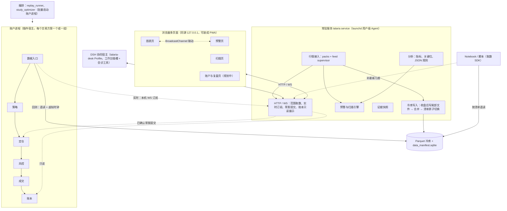
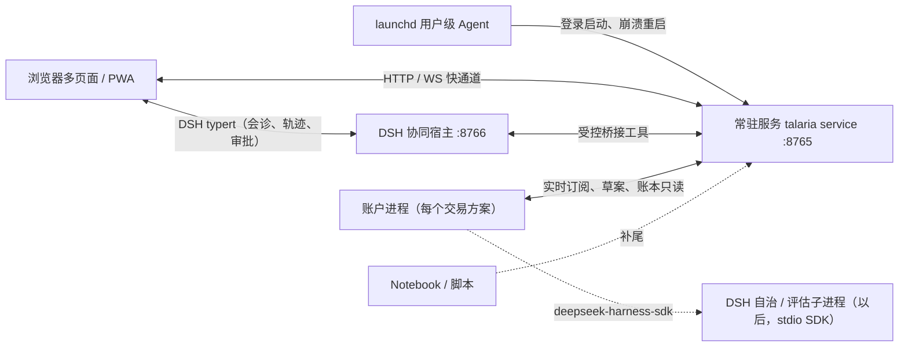

# Talaria 系统架构与模块接口规范

Talaria 是本机单用户的交易研究平台，覆盖加密永续合约与美股。产品按功能组织，参照 TradingView 的使用方式：行情数据、图表、指标与关键位、预警、扫描各自可以单独打开，也可以组合使用；出策略时，Notebook、策略、agent 和图表拿到的是同一份、同一口径的数据。策略走历史回测和模拟盘，暂不接实盘。

本文档描述目标架构、模块接口、可替换的插槽、数据模型、仿真法则与单机部署。每节标明当前状态：**已实现**、**改造中**（现有代码需要按新架构调整）或**规划中**。领域术语以根目录 [GLOSSARY.md](../GLOSSARY.md) 为准。需求与决策过程见 `.scratch/platform-redesign/spec.md`。

架构决策：

- [ADR-0001：DeepSeek Harness 与 Python 确定性底座分离的双平面架构](./adr/0001-dual-plane-dsh-and-python-core.md)
- [ADR-0002：通用标的内核与 Capability Traits 市场包](./adr/0002-capability-traits-and-market-packs.md)（按 `R` 定仓已由 ADR-0015 降为默认插件规则）
- [ADR-0003：在完整执行计划层设置 Execution Seam，模拟优先](./adr/0003-plan-level-execution-seam-simulation-first.md)
- [ADR-0004：确定性异动扫描前置门禁与日内快慢双模认知](./adr/0004-dual-mode-intraday-cognition-and-scanner-gate.md)
- [ADR-0005：看盘工作台走本地快通道并与 DSH 插槽解耦](./adr/0005-fast-path-bypass-and-decoupled-chart-workbench.md)
- [ADR-0006：子账户单标的单一仓位回合与按写者分库](./adr/0006-single-position-round-per-subaccount-and-isolated-ledgers.md)（单一仓位回合已由 ADR-0015 降为默认插件规则）
- [ADR-0007：Optuna 防过拟合寻优置于外圈编排](./adr/0007-guarded-optuna-optimization-in-outer-orchestration.md)
- [ADR-0008：初版以分析工作台为先，确定性关键位引擎](./adr/0008-analysis-first-v1-and-deterministic-key-level-engine.md)
- [ADR-0009：按模型知识截止日划分智能体评估证据等级](./adr/0009-agent-evaluation-evidence-tiers-by-model-knowledge-cutoff.md)
- [ADR-0010：指标核以纯 Python Decimal 为唯一权威](./adr/0010-pure-python-indicator-core.md)
- [ADR-0011：冷库发布由快照冻结触发](./adr/0011-cold-store-publish-on-snapshot-freeze.md)（已被 ADR-0018 取代）
- [ADR-0012：状态库写入走专用写线程，读取用只读连接](./adr/0012-state-store-dedicated-writer-thread-and-read-only-connections.md)
- [ADR-0013：L0 底座只放纯契约与纯计算](./adr/0013-foundation-holds-only-pure-contracts-and-computation.md)
- [ADR-0014：一个 launchd 常驻服务 + 浏览器多页面](./adr/0014-resident-service-and-browser-multi-page.md)
- [ADR-0015：交易流水线运行在独立的账户进程，账户进程是插件宿主](./adr/0015-account-process-as-plugin-host.md)
- [ADR-0016：取数 SDK 按清单直读 Parquet，最新部分向常驻服务补齐](./adr/0016-sdk-reads-parquet-directly-with-service-tail.md)
- [ADR-0017：冷库按标的、按列精度存 decimal128(18, s)](./adr/0017-cold-store-per-instrument-decimal128.md)
- [ADR-0018：冷库在每根 K 线收盘后持续写入](./adr/0018-cold-store-continuous-publish-on-bar-close.md)
- [ADR-0019：指标、信号、策略使用统一组件模型](./adr/0019-unified-component-model-with-runtime-context.md)

调研证据存档于 [`docs/research/`](./research/)。

---

## 1. 产品形态与进程拓扑

系统由四类进程组成。常驻服务是数据的唯一写者，其他进程都是它的使用方。



### 1.1 进程职责

| 进程 | 职责 | 写哪些存储 | 状态 |
|---|---|---|---|
| 常驻服务 | 行情接入、冷库写入、快照、指标与关键位、预警、扫描、HTTP/WS；各功能按配置开关 | 冷库、快照库、协同状态库 | 已实现为 `talaria up` 前台进程；launchd 常驻、功能开关、冷库持续写入为改造中 |
| 浏览器页面 | 每个功能一个可直接打开的路由；页面间用 `BroadcastChannel` 同步标的、周期与十字光标 | 不直接写 | 单页工作台已实现；多页面路由为改造中 |
| DSH 协同宿主 | agent 会诊、标注、预警草案；工作台插槽 | 不直接写，经服务受控接口 | 已实现 |
| 账户进程 | 按交易方案装配插件，跑回测或模拟盘 | 模拟盘：持锁子账户的账本；回放：`runs/<run_id>/` | 规划中 |
| Notebook / 脚本 | 用取数 SDK 研究；可以直接运行自己写的组件（研究模式，不隔离） | 不写 | 规划中 |

服务的生命周期独立于任何窗口：关掉所有页面后，Notebook 和账户进程仍能取到数据。服务未运行时，SDK 只读本地已有数据，回测不受影响。

### 1.2 依赖与权限铁律

1. **L0 纯净**：`foundation` 只放契约、算子和纯计算，不做 I/O（ADR-0013，由 `tests/foundation/test_import_boundaries.py` 强制）。
2. **每个存储只有一个写者，跨进程强制**（ADR-0006、ADR-0012、ADR-0014、ADR-0015）：冷库、快照和协同状态只由常驻服务写，服务持有数据目录排他锁；模拟盘每个子账户的账本只由持有该子账户排他锁的账户进程写；回放写自己的 `runs/<run_id>/`；其他进程只读。需要写协同状态的命令（如 `usage-scan`）在服务运行时经服务接口提交。
3. **开仓与放宽风险必过风控插槽，收敛风险可直达成交插槽**（ADR-0015 底线 2）：新建仓、同向加仓、放宽止损一律经过风控插槽，无论来自人工、agent 还是策略；只减不增风险的操作（收紧止损、移至保本、撤未成交入场单、减仓、全平、切 `REDUCING`/`HALTED`）直达成交插槽，成交插槽内部断言风险敞口单调不增。
4. **防前视由运行时负责**：组件只能通过 `ctx` 取数，`ctx` 按 `as_of` 截断、只在收盘后求值（ADR-0019）；SDK 与回测共用同一套截断实现（先按 `ts_available` 截断，再取最大修订，ADR-0018）。用户自己的 Python 靠截断与前视审计保证；agent 写的 Python 在模拟盘只能经宿主传入的已截断数据取数。
5. **跨品种零条件分支**：业务代码面向 L0 的能力特征与 `MarketPack` 协议编程，场所差异由 `packs/<market>/` 提供（ADR-0002）。`packs/__init__.py` 的 `MARKET_PACKS` 按名称注册，`talaria up --pack` 与 `talaria evaluate-levels --pack` 默认 `crypto_perp`。市场包提供标的与能力特征、历史连接器、实时流、原始存档目录标识（`crypto_perp` 为 `bybit_linear`）和会诊提示词中的市场领域技能文本。
6. **人工确认是宿主边界**：交易草案只有交易员确认后的不可变版本才能进入账户进程，与用哪个策略插件无关（ADR-0015）。

### 1.3 交易方式的支持范围

交易方式由交易方案的插件组合决定（ADR-0015），框架本身不限制。下表列出首批默认插件覆盖的范围，以及其他方式需要新增哪类插件：

| 交易方式 | 首批默认插件 | 需要新增 |
|---|---|---|
| 单标的趋势 / 突破 / 均值回归择时（分钟级及以上） | 支持 | — |
| 资金费率、OI 背离、基差等衍生品信号 | 支持 | — |
| 慢层 `ControllerPatch` 调参 + 快层确定性策略 | 接口预留（策略输出类型之一），首批不实现 | `ControllerPatch` 签发、边界校验与到期回退 |
| 网格、定投、持有型（无止损） | 不支持 | 名义金额定仓插件 + 不要求止损的风控插件 |
| 横截面多因子 / 目标权重再平衡 | 不支持 | 目标权重定仓插件；策略输出 `PortfolioIntent` |
| 配对 / 统计套利 / 多腿对冲 | 只能拆为独立回合 | 篮子成交插件（多腿原子开平、价差屏障） |
| 同一子账户同标的多空对冲 | 默认风控拒绝（可拆子账户） | 允许多回合的风控与成交插件 |
| 做市 / 订单簿高频 / 跨所低延迟套利 | 范围外 | 定位为分钟级及以上 |

### 1.4 实施状态与路线

M1（数据接入、冷库、指标、关键位、看盘页、价位预警）与 M2（DSH 协同会诊、标注、扫描简报）已交付。按“数据 + 策略取数优先”，后续按以下顺序推进，任务单见 `.scratch/platform-redesign/issues/`：

| 阶段 | 内容 |
|---|---|
| P1 数据底座 | 冷库数值格式迁移（ADR-0017）、持续写入与历史回填（ADR-0018）、HTTP 范围取数与补尾、取数 SDK（ADR-0016）、策略订阅语义、衍生品冷库、逐笔与买一卖一落盘 |
| P2 常驻与多页面 | launchd 常驻与单实例锁、功能开关、关键位注册表、前端多页面路由 |
| P3 组件模型 | 组件接口与 `ctx`、Python 写法、JSON 规则（收盘求值与事件驱动）、预警升级与图表规则编辑器 |
| P4 账户进程 | 插件宿主与底线、默认定仓 / 风控 / 成交插件、账本、已确认草案提交、agent 代码批准与隔离、回放编排（确定性策略） |
| 以后 | `ControllerPatch`、agent 工具插槽、认知成本入账与六维归因、评估证据等级与 `Co-Pilot Lift`、美股市场包、快讯、`study_optimizer`、Tauri 薄壳、实盘成交插件 |

初版只要求框架完整：插槽、契约、写者边界和时点语义一次定好，功能按上表逐步补齐。

---

## 2. 目录结构

```text
Talaria/
├── GLOSSARY.md                         # 领域统一词汇表
├── contracts/                          # 从 Python 导出的 JSON Schema 与算子黄金测试向量
│   ├── schemas/
│   └── operator_vectors/
├── core/src/talaria/                   # Python 确定性底座（uv 管理）
│   ├── foundation/                     # L0：Decimal、时点、能力特征、契约、算子、关键位纯函数
│   │   ├── operators/
│   │   └── key_levels/
│   ├── packs/                          # 市场包：crypto_perp（Bybit V5 Linear）；us_equity 规划中
│   ├── feed/                           # 实时状态机、缺口合成、重连回填
│   ├── replay/                         # JSONL 行情回放与可注入时钟
│   ├── perception/                     # 冷库、热流缓冲、快照、预警引擎、扫描引擎、SQLite 守卫
│   ├── evaluation/                     # 关键位质量离线评估
│   ├── workbench_api/                  # 常驻服务的 HTTP/WS 层、组合根、协同状态库
│   ├── sdk/                            # 规划中：取数 SDK（清单直读、补尾、as_of、to_frame）
│   ├── components/                     # 规划中：组件接口、ctx、JSON 规则编译与求值
│   ├── account/                        # 规划中：账户进程宿主、插槽注册、事件循环、账本
│   ├── plugins/                        # 规划中：默认插件（定仓、风控、成交、数据入口、工具）
│   ├── orchestration/                  # 规划中：replay_runner、study_optimizer
│   └── cli/                            # up / service / dsh-install / contract-check / usage-scan / evaluate-levels
├── dsh/packages/
│   ├── talaria-contracts/              # 由 Python 生成的 TypeScript 契约
│   ├── talaria-desk-ui/                # React + KLineChart v10 前端（改造为多页面路由）
│   └── talaria-dsh-plugin/             # DSH Web 插槽、bridge.js、守卫与工具 Schema
├── tests/
└── docs/
    ├── architecture.md                 # 本文档
    ├── adr/
    └── research/
```

`workbench_api/runtime.py` 是常驻服务的组合根；`workbench_api/app.py` 负责 ASGI 配置与挂载，`routes/` 按领域存放路由，`desk_broadcast.py` 负责 WS 广播。`sdk/`、`components/` 只依赖 `foundation` 与 `perception` 的只读部分，不依赖 `workbench_api`，因此 Notebook 和账户进程不需要启动 Web 层。

---

## 3. 公共底座契约层（L0 `foundation`）

**已实现**（Parquet 数值格式改造中）。封装全系统通用的数值精度、时间因果模型、跨资产特征协议与纯数学算子，不包含网络或磁盘 I/O。

1. **定点十进制与五重时点纪律**：
   - 所有价格、数量、名义本金、手续费、资金费率与账户余额在 Python 内使用 `Decimal`；跨 JSON 边界序列化为十进制字符串（`DecimalStr`）；Parquet 存储层按列用 `decimal128(18, s)`，scale 由标的精度和列类别决定（ADR-0017，改造中；当前仍存字符串）；只有前端绘制和 `.to_frame()` 研究视图转为浮点数。
   - 所有市场与事件事实区分五重时间戳：`ts_event`（`Event Time`）、`ts_published`（来源声称的发布时刻）、`ts_available`（`Available Time`）+ 精度等级 `PrecisionTier`（`SECOND_VERIFIED | SESSION_BOUND | DATE_CONSERVATIVE`）、`ts_ingested`（系统接收时刻）与 `ts_committed`（`Committed Time`）。
2. **`InstrumentSpec` 与五大可组合能力特征（`Capability Traits`）**：

| 特征接口 | 封装的市场与数据源差异 | 加密永续合约示例（`BTC-USDT-PERP`） | 美股日内示例（规划中） |
|---|---|---|---|
| `FeedCapabilityTrait` | 数据源标识 `feed_id`、实时供流窗口、心跳超时、REST 回溯上限、归档回填器 | `BYBIT_LINEAR` 全历史免密钥；`BINANCE_USDM` 近 30 天 REST + 远端归档补齐；`HYPERLIQUID_PERP` 实时落盘补 5,000 根限制 | `ALPACA_IEX`（实时仅 `08:00–17:00 ET`，≤30 标的稀疏单场所）与 `ALPACA_SIP`（历史延迟 ≥15m 全市场）严格分流标记 |
| `MarginTrait` | 保证金制度、杠杆上限、未实现盈亏与强平估值基准价 | `CROSS / ISOLATED` 初始与维持保证金率，按 `Mark Price` 判定强平 | `CASH`（全额现金禁做空）或 `REG_T`（日内 4x / 隔夜 2x 融资） |
| `CarryTrait` | 持仓跨越结算周期的现金流计提 | 整点（1h/4h/8h）按持仓名义价值与 `FundingRate` 多空直接收付 | 融券空头按年化费率跨结算日计提借券利息 |
| `SessionTrait` | 可交易时段、场所供流联动保护与强平窗口 | `24x7` 连续交易 | 盘前 / 常规 RTH / 盘后分段；绑定 `ALPACA_IEX` 时限制在有实时报价覆盖的窗口内持仓（默认 ≤`16:55 ET` 平仓） |
| `OrderConstraintTrait` | 委托标志、做空准入与监管频次限制 | 原生双向开空、支持 `POST_ONLY` 与 `reduce_only` | 非 RTH 时段禁用市价单；`< $25,000` Reg-T 账户受滚动 5 交易日 PDT 次数约束 |

上述五项为所有标的的必需能力。衍生品数据是可选扩展：支持标记价、资金费率结算或持仓量的市场包额外声明 `DerivativeCapabilityTrait(kinds, history, realtime)`；不支持的市场包不声明，核心代码只处理 `DerivativePoint`，不出现交易所或资产类别分支。

3. **双层时间序列与单一实现的确定性算子（`foundation/operators`）**：
   - **横截面网格表（`GridAlignedTable`，规划中）**：保留正常休市（`SESSION_CLOSED`）、停牌（`HALTED`）、时段内无成交（`NO_TRADES`）与异常断流（`FEED_GAP`）显式状态，服务多品种横截面对齐。
   - **单标的紧凑交易序列（`SessionCompactBars`）**：剔除正常休市空槽，保留 `FEED_GAP` 供算子重置状态。技术与衍生品算子（EMA、SMA、RSI、ATR、BOLL、VWAP、资金费率分位数、OI 背离度、净赔率几何验算）的批量输出与输入等长同序，预热期输出前导 `null`。遇到 `NO_TRADES` 时技术指标按平盘零量柱递推，衍生品算子沿用上一结果；遇到 `FEED_GAP` 时输出 `null` 并重新预热。前端跳过 `FEED_GAP` 柱，按时间戳对齐到 `KLineChart` 的 `dataList`。
   - **算子只在 Python 中实现一份**（ADR-0010）：`foundation/operators` 的 `Decimal` 实现是批量计算与增量更新的唯一权威，以 `contracts/operator_vectors/` 黄金向量回归。`TA-Lib==0.8.3` 与 `talipp==2.7.0` 保留为固定版本候选依赖，运行时不使用。组件模型的算子注册表（§5.1）以此为准。
4. **关键位纯函数算法（`foundation/key_levels`）**：摆动高低点（按 ATR 阈值的分形 / ZigZag，多周期）、触及价位聚类、成交量分布（`POC / VAH / VAL`）、锚定 VWAP 与 `±σ` 带、时段参考位、跳空缺口与整数关口均为无 I/O 纯函数。**摆动类算法不得使用确认点之后的数据**：枢轴须经 `confirm_bars` 根后续 K 线确认后才产出，可见时刻记为确认 K 线收盘时刻。

---

## 4. 数据平面（常驻服务）

### 4.1 行情接入与实时传输

**已实现**（逐笔与买一卖一落盘、策略订阅语义为规划中）。

- `foundation/feed.py` 定义跨数据源统一的 `KlineEvent`（含 `confirmed` 与单调递增 `revision`）、`OrderBookEvent`、`FeedHealthEvent` 与 `MarketEventFeed` 协议；这些契约同时导出 JSON Schema 与 TypeScript 类型。
- `feed/supervisor.py` 持有唯一状态机：12s（`stale_after_ms=12000`）无事件即 `LIVE → STALE`；传输层报错立即 `STALE`；重连成功后先 `RECOVERING` 并应用 REST 回填，再回 `LIVE`。断流窗口以“最后一根已知柱的事件时间 + 断流墙钟时长”记录，历史回放不会伪造未来时间戳的缺口。
- 缺口合成与 `perception/compaction.py` 共用 `classify_flat_bar`：正常稀疏分钟补前收平盘零量的 `NO_TRADES`；断流窗口内补 OHLCV 全空的 `FEED_GAP`。同一 `timestamp` 的多次发布按 `revision` 追加保留、后到者胜，REST 回填与实时推送可安全重放。
- `packs/crypto_perp/stream.py` 是 Bybit V5 Linear 公共 WS 传输层：topic 为 `kline.{interval}.{symbol}`、`orderbook.1.{symbol}` 与 `tickers.{symbol}`（标记价、资金费率、持仓量的实时读数来源），等待订阅 ack、应用层 ping/pong、断线由 supervisor 指数退避重连。**规划中**：对实时订阅的标的增加 `publicTrade.{symbol}`，把买一卖一与逐笔成交落盘（§4.2）。
- `workbench_api/subscriptions.py` 按“当前图表 > 活跃预警 > 自选顺序”分配实时订阅配额（已实现；预警固定按 `1m` 订阅）。**改造中**：配额按 `(标的, 周期)` 记在各使用方名下，使用方包括图表页、预警（按自己的周期）、账户进程和自选；账户进程的订阅优先保留，配额不足时明确拒绝；被挤掉的使用方收到通知。
- **实时订阅的两种语义**：
  - 图表页面（`WS /ws/desk`，已实现）：每客户端一条有界队列（256），满则丢最旧，慢客户端不阻塞广播；前端 `useMarketStream` 指数退避重连，切换标的或周期时先退订再订阅；图表增量走 KLineChart v10 的 `DataLoader.subscribeBar`，`FEED_GAP` 不进入 `dataList`。
  - 策略订阅（规划中，ADR-0016）：不静默丢弃，队列满则断开。交付单位是一个已收盘柱的修订，带变更序号 `(epoch, seq)`。重连时客户端带上最后序号，服务先挂实时订阅并缓冲，再从变更日志补发、按序号去重；序号超出保留范围或 `epoch` 变化时要求客户端经范围接口重新同步。实测本机 WS 从事件到策略回调 p99 约 1–2 ms。
- `talaria up --solo --pack crypto_perp --data-dir <临时目录> --fixture-dir <fixture> --replay-events <path> [--replay-speed F]` 用 JSONL 回放驱动实时链路，用于离线确定性与浏览器验收；`/api/health.feed_mode` 区分 `fixture` / `replay` / `bybit`。回放会写冷库、快照和协同状态，必须指定独立的数据目录；不给 `--fixture-dir` 时历史快照会走真实历史连接器。**改造中**：回放模式拒绝使用日常数据目录。

### 4.2 冷库

**改造中。** 当前冷库在快照冻结时发布（历史回填也随快照构建发布）、以字符串存价格（ADR-0011）；衍生品另存为快照文件，不在冷库中。目标如下。

1. **持续写入**（ADR-0018）：
   - 两条写入路径，同一个冷库写入器：每根 K 线 `confirmed` 后写入该分区的尾部小文件；服务按需用 REST 回填启动前的历史并直接写入冷库，不经快照。
   - 定期把尾部文件合并进分区文件，在 `data/data_manifest.sqlite` 中短事务原子切换清单。
   - 每个修订单独一行，带自己的 `revision` 与 `ts_available`：首个已收盘版本为柱结束时刻，之后的修订为服务收到它的时刻。合并不丢修订；读取时先按 `ts_available <= as_of` 截断，再对每个 `ts_event` 取最大 `revision`。
   - 被替换的文件至少保留若干代清单且不少于 24 小时；读者读到已删文件时按新清单整次重试一次。
   - 写入失败只记 warning，不阻塞行情与图表。写入顺序保留现有纪律：内容哈希归档 → staging Parquet 质检 → 落盘并 `fsync` → 清单短事务提交。
2. **目录布局**：

| 数据集 | 分区 | 内容 |
|---|---|---|
| K 线 | `标的/周期/月` | OHLCV、`turnover` 与时点列 |
| 逐笔成交 | `标的/日` | 实时订阅标的的逐笔；历史从 Bybit 公开归档 `public.bybit.com` 按日补 |
| 买一卖一 | `标的/日` | 实时订阅标的的 L1 盘口；多档盘口暂不存 |
| 衍生品 | `标的/类别/月` | 标记价、资金费率、持仓量；实时来自 `tickers.{symbol}`，历史经 REST 回填；资金费率结算点生成结算事件 |
| 公司行为（美股，规划中） | `标的` | 拆股、分红；读取时按 `as_of` 复权 |
| 快讯（暂缓） | `来源/日` | 见 `.scratch/platform-redesign/spec.md` D5 的设计约束 |

3. **数值与列**（ADR-0017）：每个标的一个文件，数值列为 `decimal128(18, s)`，物理 INT64。scale 按列：价格类取价格精度，数量类取数量精度，`turnover` 取两者之和，资金费率固定 8；超出 scale 或 18 位整批拒绝。列：`ts_event`、OHLCV 与 `turnover`、`ts_available`、`ts_ingested`、`ts_committed`（int64 毫秒）、`precision`（字典编码）、`revision`。
4. **容量**：BTC 永续逐笔约 255 万笔/天，Parquet 约 15 MB/天；加买一卖一估算约 30–65 MB/天。落盘后用容量统计命令持续记录，满 1–2 周再定存储预算（以后）。
5. **清单**继续自写，暂不采用 DuckLake（ADR-0016）。读者只读清单显式列出的文件，并校验哈希。

### 4.3 取数 SDK 与范围查询

**规划中**（ADR-0016）。

```python
from talaria import sdk

bars = sdk.bars("BTC-USDT-PERP", "1m", start="2026-11-01", end=None, as_of=None)
bars[-1].close            # Decimal
df = bars.to_frame()      # float DataFrame，供研究

trades = sdk.trades("BTC-USDT-PERP", start="2026-11-19", end="2026-11-20", as_of=None)
funding = sdk.derivatives("BTC-USDT-PERP", "funding_rate", start="2026-11-01")
async for ev in sdk.subscribe("BTC-USDT-PERP", "1m"):   # 策略订阅语义，断线自动补齐
    ...
```

- 历史部分按清单直读 Parquet；冷库尚未写入的最新几根向服务的 `GET /api/bars?instrument=&timeframe=&start=&end=&as_of=` 取，按 `(ts_event, revision)` 拼接去重；服务未运行时只用本地数据，并在结果上标记未补尾。
- 补尾部分带 `confirmed` 与 `revision`（热缓冲需保留这两个字段）。默认只返回已收盘的柱；收盘时刻已过但确认未到的柱不算收盘。图表可以显式请求进行中的柱。
- 所有查询（K 线、逐笔、买一卖一、衍生品）都支持 `as_of`：先按 `ts_available <= as_of` 截断，再取最大 `revision`；回测数据入口与组件 `ctx` 用同一实现。
- 返回 `Decimal` 契约对象；`.to_frame()` 只在研究视图里转 float。
- DSH 工具与 SDK 共用同一套 HTTP 契约。
- 待实测：服务补尾与直读在并发读写下的一致性；Arrow IPC 经本机 HTTP 传输千万行的耗时。

### 4.4 证据快照

**已实现。** 快照用于固定 agent 会诊、预警与扫描触发时的证据。**改造中**：图表目前仍先创建快照再取历史；范围接口（§4.3）交付后，日常取数不再需要先建快照。

- `SnapshotBuilder` 合并已归档柱与 `HotStreamBuffer` 的近期柱，按 cutoff 裁剪、紧凑化，把冻结结果写入 `state/hot_snapshots/<snapshot_id>.parquet` 并登记于 `state/runtime_snapshots.sqlite`。快照查询读取登记的物化文件。
- 时点模式：`HISTORICAL_PIT` 约束 `ts_available <= cutoff_ts`（已实现）；`OBSERVED_REPLAY` 额外约束 `ts_committed <= cutoff_ts`（规划中）。
- 新增 HTTP 按时间范围取快照内数据（规划中）。

### 4.5 事件日历

**规划中**（随美股市场包）。

- 预期侧存储 `scheduled_date`、`scheduled_session`（`BMO | DMH | AMC | EXACT_UTC | DATE_ONLY`）、`scheduled_ts_utc`（BLS `.ics`、BEA JSON/ICS、FOMC 官方时刻表；近端财报排期由 Finnhub 免费层每日增量快照积累）与排期获知时刻 `schedule_available_ts`。
- 实际披露侧存储 `actual_payload`、`ts_available` 与 `PrecisionTier`：美股财报采用免密钥 SEC EDGAR `submissions`（`8-K` Item `2.02` / `10-Q` / `10-K`）经美东时区与 Reg S-T `17:30 ET` 规则校准的秒级 `acceptanceDateTime`（辅以 Alpaca News 秒级 `created_at`）；宏观修订序列接入 FRED / ALFRED `vintagedates`。
- **防前视裁剪**：`cutoff_ts < effective_available_ts` 时隐藏 `actual_payload`（置为 `UNRELEASED`）。`SECOND_VERIFIED` 取精确时刻；`SESSION_BOUND` 将 `BMO` 保守折算至当日 `09:30 ET`、`AMC` 折算至 `20:00 ET`（由 `us_equity` 的 `SessionTrait` 提供）；`DATE_CONSERVATIVE` 推迟至 `SessionTrait.next_regular_open(date)`。缺少历史事前排期的美股回测区间标记 `EarningsScheduleCoverage = EX_POST_ONLY` 并在报告中披露。

### 4.6 快讯

**暂缓。** 设计约束（统一快讯契约、每个数据源一个插件、按来源/日分区、逐条标记能否供策略与 agent 使用、删除同步用追加标记加定期重写）与备选数据源组合记录在 `.scratch/platform-redesign/spec.md` 的 D5 与 `docs/research/news-feed-data-sources.md`。

---

## 5. 分析与组件模型

### 5.1 组件接口与运行时上下文

**规划中**（ADR-0019）。指标、信号、策略是三类组件，上一类可以引用下一类：

```python
class Component(Protocol):
    meta: ComponentMeta    # 名称、版本、输入、参数及取值范围、输出类型

class Indicator(Component, Protocol):
    def compute(self, ctx: Ctx) -> Series: ...          # 数值序列

class Signal(Component, Protocol):
    def evaluate(self, ctx: Ctx) -> list[SignalEvent]: ...

class Strategy(Component, Protocol):
    def on_bar(self, ctx: Ctx) -> StrategyDecision: ...  # SetupInsight / ControllerPatch / Abstain
```

- `ctx` 是组件取数的唯一入口：`ctx.bars(timeframe)`、`ctx.indicator(name, **params)`、`ctx.derivatives(kind)`、`ctx.now`。`ctx` 按 `as_of` 截断，只在 K 线收盘后求值；只暴露已确认的柱；跨周期只能看到大周期最近一根已收盘的柱。
- 算子注册表：每个可被组件引用的算子带名称、参数 Schema、版本和黄金向量；JSON 规则只能调用已注册算子。
- `ComponentMeta` 的参数取值范围供 `study_optimizer` 寻优使用。

### 5.2 写法

| 写法 | 运行位置 | 用途 | 状态 |
|---|---|---|---|
| Python | 用户自己的代码：Notebook（研究模式，不隔离）或账户进程；agent 写的代码进模拟盘：账户进程下的受限子进程（需批准） | 策略、自定义指标与信号 | 规划中 |
| JSON 规则（带版本号的表达式树） | 常驻服务或账户进程 | 图表规则、预警、扫描、简单策略 | 规划中 |
| 文字语法 / Pine 风格子集 | 编译为 JSON 规则 | 图表上手写规则 | 以后 |

规则分两种求值时机（ADR-0019），在 Schema 中显式声明：

- **收盘求值**：指标、信号、策略及引用它们的规则，经 `ctx` 在 K 线收盘后求值。
- **事件驱动**：价格触碰画线或关键位、买一卖一与资金费率阈值，在每个行情事件到达时求值；只能拿当前事件的值比较常量、画线、关键位或已收盘的组件输出。

现有 `AlertCondition` 只能表达单个条件，升级为 JSON 规则，原来盘中触发的条件迁移为事件驱动规则，触发时刻与冻结证据不变；配图表规则编辑器。不采用受限 Python 作为规则语言，不采用现成 Pine 实现。

### 5.3 预警与扫描

**已实现**（规则形式改造中）。

- `perception/alerts` 的 `AlertEngine` 支持价格/衍生品阈值、技术指标交叉、画线触碰/收盘突破和关键位事件（触及 / 突破 / 回踩，按 `level_id` 跟踪）。`perception/scanner` 的 `ScannerEngine` 维护扫描窗口与触发冷却。两者接收实时流或 JSONL 回放的同一套 `MarketEventFeed` 事件。
- `Trigger Routing Policy` 决定触发只做本地提醒还是进入协同简报（ADR-0004）。
- 改造：预警条件改为 JSON 规则（收盘求值或事件驱动）；预警按自己的周期订阅行情（当前固定 `1m`，非 `1m` 的指标预警收不到 K 线）；预警与扫描作为常驻服务的可开关功能。

### 5.4 确定性关键位引擎

**已实现**（关键位发布方式改造中）。

- 服务调用 `foundation/key_levels`，按冻结快照的 `cutoff_ts` 产出绑定 `snapshot_id` 的不可变 `KeyLevelSet`。
- **改造**：当前关键位只在 `POST /api/snapshots` 路由里写入广播器缓存，没有前端创建快照时关键位预警拿不到数据。改为服务内的关键位注册表：
  - 任何来源的快照冻结都写入一个带 `cutoff_ts` 的 `KeyLevelSet` 版本；
  - 服务启动时为有活跃关键位预警或实时订阅的 `(instrument, timeframe)` 按当前时刻从冷库算一版预热，不依赖扫描或前端；
  - 预警按事件时刻读 `cutoff_ts <= 事件时刻` 的最新版本，不把之后才形成的 `BROKEN / FLIPPED` 状态用到更早的事件上；图表读最新版本。
- 初版价位类别：① 结构位（确认后的摆动高低点、多次触及聚成的支撑阻力区间）；② 时段参考位（前日高 / 低 / 收、周与月开盘价、开盘区间、加密亚洲 / 伦敦 / 纽约时段高低点；美股盘前高低点规划中）；③ 成交量位（`POC / VAH / VAL`、锚定 VWAP 及 `±σ` 带）；④ 未回补跳空缺口与整数关口；⑤ 基于 OI 变化与杠杆假设推算的清算密集区（`evidence_class` 为 `ESTIMATED`，与观测类价位分开展示）。
- 契约 `KeyLevel`：`level_id`（跨快照稳定）、`instrument_id`、`kind`、`price` 或 `[low, high]` 区间、`timeframe`、`strength` 及其构成、`status`（`ACTIVE | BROKEN | FLIPPED`）、`ts_available`、`method_version` 与参数。
- 质量评估：离线统计各 `kind` 被触及后 `X` 倍 ATR 内出现反应的比例并与随机价位对照；人工的采纳 / 忽略记入协同状态库。

### 5.5 图表图层与人机共用接口

**已实现**（`EXECUTION_BARRIER` 规划中）。前端基于 `KLineChart v10`（Apache-2.0），已锁定 `klinecharts 10.1.1`：外部指标结果通过注册指标模板并以 `createIndicator({ name, calc })` 返回与 `dataList` 等长同序的数组，更新时换新闭包并调用 `overrideIndicator`；历史分页使用 `setDataLoader`。组件输出（§5.1）以同样方式显示。

| 图层（`groupId`） | 写入主体与存储 | 交互与校验 |
|---|---|---|
| `HUMAN_DRAWING` | 交易员绘制；持久化于 `collaboration_state.sqlite` | 自由拖拽（前端乐观重绘、松手落库）、撤销重做、一键挂载 `OVERLAY_CROSS` 预警 |
| `SYSTEM_LEVEL` | 经 WS 单向投影，不入画线表；当前来源是快照路由写入的广播器缓存，改为关键位注册表（§5.4）后来源随之切换 | 只读；按 `kind` / 强度过滤；一键采纳为 `HUMAN_DRAWING` 或挂载 `LEVEL_EVENT` 预警；采纳 / 忽略记为质量反馈 |
| `AGENT_ANNOTATION` | agent 调用 `write_agent_overlay`，经硬门控后存入 `collaboration_state.sqlite` | ① 校验 `snapshot_id` 与非空 `evidence_refs`（须引用 `level_id` 或具体 K 线时间戳）；② 价格锚点为正、合乎 `tick_size`，且落在 `[min_low - 3*ATR_14, max_high + 3*ATR_14]` 内；③ 单标的未采纳活跃条数 ≤12 |
| `EXECUTION_BARRIER`（规划中） | 账户进程的草案与活跃回合经服务单向投影 | 拖动草案线触发定仓插件预试算；拖动活跃止损线按收紧/放宽方向路由到成交插槽或风控插槽 |

**人机共用分析接口**：浏览器与 agent 是同一套接口的两个调用方，读到的数据、算法与 `cutoff_ts` 一致，`level_id` 共享。接口由服务提供，经 `talaria-dsh-plugin/bridge.js` 包装为 agent 工具；签名以 `bridge.js` 与导出的工具 Schema 为准。

| 接口 / 工具 | 作用 | 权限 |
|---|---|---|
| `get_snapshot` | 冻结截止时刻，返回 `snapshot_id`，后续调用绑定该快照 | 只读 |
| `get_indicators(snapshot_id, timeframe, names, limit)` | 快照内的指标序列与摘要 | 只读 |
| `get_key_levels(snapshot_id, timeframe, categories, limit, min_strength)` | 按强度排序的 `KeyLevel` 及强度构成 | 只读 |
| `compute_operator(snapshot_id, timeframe, operator, ...)` | 以非默认参数临时调用算子 | 只读 |
| `get_chart_view` | 当前标的、周期、视窗与可见 `HUMAN_DRAWING` | 只读 |
| `write_agent_overlay` | 写入 agent 标注（经上表硬门控） | 受控写 |
| `create_alert` | 以草案形式创建预警，人工确认后生效 | 草案 |

返回值为带 `snapshot_id` 与稳定 ID 的结构化 JSON 加摘要；agent 不能修改关键位或指标结果。不接入自行拉取行情的第三方技术分析 MCP，以免绕过冻结快照。

---

## 6. 账户进程与交易方案

**规划中**（ADR-0015）。原 L2–L5 分层的设计在这里作为第一批默认插件保留。

### 6.1 宿主、插槽与底线

账户进程承载一个或一组子账户。一个**交易方案**是一份配置，为每个插槽选一个插件：

```yaml
scheme: btc-breakout-paper
interface_version: 1
sub_accounts: [sa-breakout]   # 模拟盘时宿主对每个子账户取排他锁
slots:
  data: live_ws            # 回测时换成 parquet_replay
  strategy: {python: strategies/breakout.py, params: {lookback: 20}}
  sizing: r_unit           # 按止损距离定仓
  risk: seven_step         # 七步风控 + 单一仓位回合不变量
  fill: bar_sim_1m         # 或 l1_trade_sim
  tools: []                # 工具插槽接口预留，首批不实现
```

| 插槽 | 首批默认插件 | 以后可加 |
|---|---|---|
| 数据入口 | 实时本机 WS；回测 Parquet + 虚拟时钟 | 其他数据源 |
| 策略 | 组件模型的策略：Python、JSON 规则 | agent 自治交易计划、`ControllerPatch` |
| 定仓 | 按止损距离定仓（`R`） | 名义金额、波动率、目标权重 |
| 风控 | 七步风控 + 单一仓位回合不变量 | 网格、定投、再平衡所需规则 |
| 成交 | 1m K 线模拟（六条诚实仿真法则）；买一卖一加逐笔模拟 | 实盘（`Execution Seam`，ADR-0003） |
| 工具 | 接口预留，首批不实现 | agent 可调用的工具集，按方案开放 |

固定底线（改动需要新 ADR）：

1. 事件顺序与时钟：数据 → 策略 → 定仓与风控 → 成交 → 记账；回测与实时同一时钟语义；组件取数经 `ctx` 截断。
2. 开仓、加仓、放宽止损必须经过风控插槽；只减风险的操作直达成交插槽。三种来源同样适用。
3. 账本格式统一，每个子账户的账本只有一个写入方，由宿主跨进程强制：模拟盘按子账户取排他文件锁，第二个声明同一子账户的进程启动失败；回放写独立的 `runs/<run_id>/`。
4. 插件接口带版本号，插件声明兼容的接口版本。

连接方式：

- 回测与模拟盘是同一个账户进程，只换数据入口。
- **插槽交接**：策略输出意图（方向、入场、止损、目标），不决定数量；定仓插件输出 `SizingDecision`（数量与计算依据）；风控插件只批准或拒绝这个数量，不重算、不改大。保证金与强平估值是定仓、风控、成交共用的只读契约 `MarginValuation`，由市场包实现（现有 `MarginTrait` 只有保证金币种与杠杆上限，需补）。
- **草案提交**：图表人工下单和 agent 会诊产出的 `Staged Plan Draft` 保存在服务，可反复编辑。交易员确认后，服务把不可变的已确认版本（草案 ID、版本号、内容哈希、确认人与时刻）提交给对应账户进程；宿主按 `(草案 ID, 版本号)` 幂等接收，重新冻结快照，入场价带已被越过或已触及止损时返回 `DRAFT_STALE`，否则送定仓与风控。草案不经策略插槽，未确认的草案没有进入账户进程的通道。草案生成至确认的时长记为 `deliberation_ms`，不计入 `Decision Latency`。
- **agent 写的代码**：agent 默认产出交易计划或 JSON 规则，都经过风控插槽。agent 写的 Python 策略可以自由回测；进模拟盘前需要人工批准与代码内容哈希绑定的版本，代码改动即失效；运行在资源受限、无网络、读不到数据目录的子进程中，只能经宿主传入的已截断数据取数。宿主在模拟盘启动时检查批准。
- 服务只读账本用于展示。

### 6.2 默认策略插件

消费 `ctx` 与冻结的 `EvidenceSnapshot`，产出方向观点或受限参数补丁，不感知账户本金，不直接触碰成交插槽。

1. **三类来源汇入同一流水线**：
   - 确定性策略：Python 组件或 JSON 规则，既是快慢双模中的快层执行载体，也是衡量 agent 净超额收益的基线对照组。
   - agent 策略（以后）：按“静态风控契约前缀 → 匹配 `Market Pack` 的领域技能 → 当前快照增量”三段式组装提示词以提高前缀缓存命中率，在 PTC 中调用同口径算子；缺止损价、止损/止盈几何倒挂、越界引用或推理超时时一律降级为 `Abstain`。
   - 草案不属于策略插件：`StagedPlanDraft` 的编辑状态（`STAGED → MODIFIED → CONFIRMED | DISCARDED | EXPIRED`）由服务保存，已确认版本由账户宿主接收（§6.1），统一封装为带 `DecisionOrigin`（`HUMAN | CO_PILOT | AGENT`）的 `PlanCandidate` 后与策略产出的意图走同一条定仓与风控路径。
2. **`ControllerPatch` 生命周期（以后）**：只能修改目标策略参数取值范围内的参数，携带 `valid_until_ts` 与 `dsh_turn_id`，到期未续签回退默认参数；生效期内的交易标记 `cognition_mode = CONTROLLER_PATCH`。

### 6.3 默认定仓与风控插件

新建仓、同向加仓及放宽止损的确定性放行关口。

1. **子账户隔离与单一仓位回合不变量**：
   - 每个 `Sub-Account` 独立配置初始资金、计价币种、保证金模式、风险单元比例 `r_unit_pct`、相关性簇上限、回撤熔断阈值及 `TradingState`。
   - 同一 `(sub_account_id, instrument_id)` 同一时刻最多一个方向的活跃或挂单回合；同向加仓并入当前回合；反向开仓拒单（`OPPOSITE_POSITION_OPEN`）。
   - 加仓以 `AddOnCandidate` 提交并携带 `round_id`，沿用回合屏障；按当前回合止损计算加仓后总风险，不得突破 `max_single_r_pct`。需要不同止损时先改屏障再加仓。
   - **串行审批与风险预留**：账户进程内每个子账户一条串行审批队列，`evaluate_candidate → submit_plan → 登记预留` 在同一临界区完成；预留记录已放行但账本尚未可见的 `R`、保证金与回合，入账或撤销后释放。
2. **接口**：
   - 定仓插件：`size(candidate, account_state, valuation) -> SizingDecision`；`preview_sizing(draft, account_state, valuation) -> SizingPreview`（无副作用，支撑前端拖动止损线 `< 5ms` 回显仓位与强平距离）
   - 风控插件：`evaluate_candidate(candidate, sizing, account_state, valuation) -> ApprovedExecutionPlan | RejectedPlanRecord`
   - 风控插件：`approve_barrier_widening(req, account_state, valuation) -> ApprovedBarrierAmendment | RejectedPlanRecord`
3. **七步风控**：
   - ① 校验 `TradingState == ACTIVE`、日内与峰值回撤未触熔断线，`invalidation_price` 必填、方向几何合法；
   - ② 核对定仓结果：按 `SizingDecision` 的数量、最差入场价与止损反算亏损，不得突破 `max_single_r_pct`（手动指定数量同样核对）。默认定仓插件 `r_unit` 按止损距离与双边摩擦缓冲 $c_{\text{buf}}$ 反推数量：
     $$Q_{\text{raw}} = \frac{E_{\text{sub}} \times r_{\text{unit}}}{\left(\lvert P_{\text{entry,worst}} - P_{\text{stop}} \rvert + P_{\text{entry,worst}} \times c_{\text{buf}}\right) \times M}$$
   - ③ 校验相关性簇的在途与持仓风险 $\sum R_{\text{open}}$ 未超上限（移动止损越过保本线的仓位释放 $R$ 占用）；
   - ④ 校验 `SessionTrait`、`OrderConstraintTrait` 及可选的重大事件静默窗口；
   - ⑤ 按 `MarginTrait` 与最新 `Mark Price` 核算保证金，硬止损须先于强平触发：逐仓校验单仓预估强平价；全仓由 `MarginValuation` 做账户级压力测试（规划中，现有 `MarginTrait` 无此方法）；
   - ⑥ 按 `CarryTrait` 扣除手续费、滑点与持仓期内资金费率/融券成本后，校验净收益风险比；
   - ⑦ 签发不可变 `ApprovedExecutionPlan`（`plan_id`、`round_id`、`sub_account_id`、`DecisionOrigin`、`ExitBarrierSpec`、`ts_decision`）。
4. **回撤熔断**：监听 `Mark Price` 与账本变动，触及日内回撤软阈值切 `REDUCING`，触及硬线切 `HALTED`，按 `liquidate_on_halt` 配置下发全平。

### 6.4 成交插槽与默认模拟成交

成交插槽的接口就是 `Execution Seam`（ADR-0003）：

```python
class ExecutionEngine(Protocol):
    def submit_plan(self, plan: ApprovedExecutionPlan) -> PlanReceipt: ...
    def tighten_barrier(self, req: BarrierTightenRequest) -> BarrierReceipt: ...
    def apply_approved_amendment(self, amendment: ApprovedBarrierAmendment) -> BarrierReceipt: ...
    def intervene_position(
        self, round_id: str, action: Literal["CANCEL_ENTRY", "CLOSE_ALL", "REDUCE_RATIO"], ratio: Decimal | None, reason: str
    ) -> RoundStatus: ...
    def set_trading_state(self, sub_account_id: str | None, state: TradingState, reason: str) -> None: ...
    def poll_events(self, up_to_ts: int) -> list[ExecutionEvent]: ...
```

1. **`PositionExecutor` 四重保护屏障状态机**：每个执行器托管一个完整 `Position Round`。状态流转 `PENDING_ENTRY → PARTIALLY_FILLED_PROTECTED → ACTIVE_PROTECTED → EXITING → CLOSED | CANCELLED | LIQUIDATED`。首笔部分成交即按已成交量挂载硬止损、止盈、激活式单调移动止损与 `max_holding_ms` 时间上限，在本地闭环，不依赖模型或前端在线。
2. **1m K 线模拟成交的六条诚实仿真法则**：
   - ① **决策延迟墙**：冻结于 $t_{\text{decision}}$ 的计划只能与 $t \ge t_{\text{decision}} + \Delta t$ 之后的行情撮合；
   - ② **挂吃单区分**：`POST_ONLY` 穿价即拒；`LIMIT` 须后续行情实质穿价才计 Maker 费率；主动吃单叠加点差与冲击滑点并计 Taker 费率；
   - ③ **同根 K 线先止损**：没有逐笔路径时，同根 K 线同时触及止损与止盈一律按先止损结算；
   - ④ **跳空真实滑点**：开盘跳空越过止损位时按跳空后真实可成交价结算；
   - ⑤ **`Mark Price` 强平与持仓现金流**：每步按只读 `MarginValuationView` 检查维持保证金率并触发 `PositionLiquidated`；跨越结算点生成 `FundingSettled`，美股空头跨日生成 `BorrowFeeAccrued`；
   - ⑥ **确定性可复现**：相同数据、摩擦配置与种子下，规范化后的执行事件与复式分录一致（剔除 `run_id`、墙钟时间与数据库物理布局）。
3. **买一卖一加逐笔模拟成交**：逐笔与报价分别判断覆盖和时效。有逐笔的区间按成交顺序判定止损与止盈先后，取代法则 ③ 的悲观假设；吃单价有新鲜报价时按买一卖一，只有逐笔或报价过期时按逐笔价加配置点差；两者都没有时退回 1m K 线模拟。每笔成交标注所用的降级档位。
4. **实盘成交插件（以后）**：持久化 Outbox、幂等 `client_order_id`、超时 `UNKNOWN` 主动对账与场所连接器全部封装在插件内，其他插槽不改。

### 6.5 账本与复盘

1. **多子账户十进制复式账本**：仅追加 `ledger_entries` + `ledger_postings` 双表，模拟盘每个子账户一个账本，回放每个 `run_id` 一个账本，按 `(run_id, sub_account_id, currency)` 隔离核算可用现金、挂单冻结、保证金、已结毛利、手续费、资金费率/融券收支与强平罚金，每次写入校验借贷差为 `Decimal('0')`。账本由承载该子账户的账户进程单写，服务只读。
2. **认知成本流水（`EXPENSE_LLM_COGNITION`，以后）**：每次 DSH 模型调用（含成交、`Abstain`、风控拒单、超时撤单、废弃草案、会诊与 `ControllerPatch`）都写入认知成本，子账户净收益与净夏普扣减同期全部推理开销。`talaria-desk` 会话绑定 `sub_account_id`，由桥接层在每轮结束时上报 `(dsh_session_id, dsh_turn_id, 输入 / 缓存命中 / 输出 Token)`，按 `(dsh_session_id, dsh_turn_id)` 幂等入账；缺失用量标记待补，不按 0 入账；定期扫描 `$DSH_HOME` 轨迹补齐漏报；无法归属的计入默认子账户的 `UNALLOCATED`。
3. **六维全成本瀑布与 `Co-Pilot Lift`（以后）**：按完整回合拆解 `无摩擦理论毛利 − 决策延迟漂移 − 撮合滑点 − 手续费 + 资金费率/融券净额 − 认知成本 = 真实净收益`，与账本结转盈亏恒等。`Co-Pilot Lift` 在草案生成时刻用独立的反事实沙箱跑原始草案（被风控拒单则基准记 0），量化人机协同相对纯 agent 的边际贡献。
4. **`Trade Journal`**：每笔终态回合自动建档，绑定 ① 执行、改止损与六维归因明细；② 开平仓 `snapshot_id` 及当时可见的 `HUMAN_DRAWING / AGENT_ANNOTATION / EXECUTION_BARRIER` 冻结副本；③ 指向 `$DSH_HOME` 轨迹的 `dsh_session_id / dsh_turn_id / patch_id` 与草案修订 Diff；④ 人工纪律标签与复盘总结（经验只在完全平仓后带 `resolved_ts` 归档，回测检索过滤 `resolved_ts <= cutoff_ts`）。

---

## 7. 编排：回放、寻优与评估

**规划中。** 编排器不自己跑交易逻辑，而是批量启动账户进程（ADR-0015）。

1. **`replay_runner`**：为一个交易方案启动数据入口为 Parquet + 虚拟时钟的账户进程，结果写入 `runs/<run_id>/`。首批只支持确定性策略，报告净收益、回撤、交易笔数与已入账的手续费、资金费率；含 agent 的回放与认知成本、证据等级一起以后做，在此之前入口拒绝含 agent 的方案。
2. **`study_optimizer`（Optuna，ADR-0007，以后）**：
   - 适用范围：截断前视审计与逐字节确定性只适用于确定性策略及 agent 调用的确定性工具；含 LLM 的策略按第 3 条证据等级评估。
   - 前置双审计：启动前执行 ① 截断式前视一致性审计（随机抽取截断点 $t_k$，断言 `cutoff=t_k` 与全区间下 $\le t_k$ 的输出逐字节一致）与 ② 递归指标预热漂移审计（对比 `1x` 与 `2x warmup_bars` 起点），任一不过即阻断。
   - 三段封存切分：绑定不可变 `dataset_snapshot_id`，切为 `Train` / `Validation`（交界处插入 $\ge \text{max\_holding\_ms} + \text{warmup}$ 的 `embargo`）/ `Holdout OOS`；寻优期传给账户进程的数据入口在接口层裁除 `Holdout OOS`（多目标模式用 `trial.set_constraint` 约束最低交易笔数与回撤上限）。
   - 全量试验计数：多 Worker 追加写 `Optuna JournalStorage`，结束后主进程把含失败与淘汰在内的完整 `n_trials` 写入 `study_registry.sqlite`。
   - 晋升门禁：最优参数须通过 `±5% / ±10%` 邻域平坦度检验，再在 `Holdout OOS` 上做唯一一次终审；寻优基于 `ALPACA_SIP` 而目标为 `ALPACA_IEX` 时，禁止绝对成交量阈值并补做同源切片核验，人工签字后上线。
3. **智能体评估证据等级（ADR-0009，以后）**：
   - `SHADOW_FORWARD`（实时前向）与 `POST_CUTOFF_REPLAY`（区间晚于全部参与模型截止日 + 默认 30 天缓冲）是晋升、`Co-Pilot Lift` 与跨子账户对比的唯一证据，须计入手续费、资金费率与滑点，并报告样本长度与统计不确定性；
   - 其余回放记为 `DIAGNOSTIC`，只用于调试；美股诊断回放同时运行匿名化对照，加密永续诊断回放不用于评估 alpha；模型升级后落入新截止日的区间自动降级；
   - `decay = 指标(截止后) − 指标(截止前)` 作为常规指标；
   - 回放中的 LLM 响应按 `(模型版本, prompt 哈希, snapshot_id)` 录制复用。

---

## 8. 部署、通信与存储

### 8.1 进程与通信



- **运行方式**：
  1. `talaria up --pack crypto_perp`（已实现）：前台启动服务与 `dsh --profile talaria-desk --no-open --port <dsh_port>`；`--solo` 只启动服务，访问 `http://127.0.0.1:8765/desk`。双进程模式在 `<data-dir>/runtime/dsh-bridge.json`（0600）写入回环基址与 Bearer Token；DSH 缺失或启动失败时宿主标为 `offline`，快通道继续服务。
  2. `talaria service install | uninstall | status`（规划中）：写入 launchd plist（显式 `ProcessType`、`KeepAlive`），服务常驻；功能开关由数据目录下的配置文件决定。
  3. `talaria account run <scheme.yaml> [--mode backtest|paper]`（规划中）：启动一个账户进程；`paper` 模式对方案里的每个子账户取排他锁，取不到即退出。
  4. `talaria replay` / `talaria optimize --workers N`（规划中）：批量启动账户进程。
- **DSH 权限隔离与版本**：`talaria-desk` 提供分析查询、标注与预警草案工具；交易草案经人工确认。以后的自治子账户（`talaria-auto`）与评估（`talaria-eval`）基于 `sdk-minimal` 剔除 shell、外网与文件写权限，由 Python 经 `deepseek-harness-sdk`（stdio）调用。截至 2026-11-19，本机基线锁定 `dsh 0.2.2-rc.3` 与 `deepseek-harness-sdk 0.2.2rc2`；客户端插槽由 DSH 安装包自带。可用 `--dsh-bin` 或 `TALARIA_DSH_BIN` 指定 DSH 可执行文件。升级前须重跑 `dsh --profile <name> --dump-config` 与确定性探针。
- 零 Docker / 零 Redis / 零 Kafka。

### 8.2 按写者拆分的本地存储

数据目录由 `--data-dir` 指定，默认取 `TALARIA_DATA_DIR` 或 `./.talaria`。SQLite 库均使用 `WAL`。`perception/sqlite.py` 现有的单写者守卫只在进程内有效；跨进程由文件锁保证（规划中）：服务持有 `runtime/service.lock`，模拟盘账户进程持有 `accounts/<sub_account_id>/owner.lock`。现有 `talaria usage-scan` 会另开写连接直写协同状态库，改为服务运行时经服务接口提交、服务未运行时先取 `service.lock`。

| 存储路径 | 唯一写者 | 内容 | 状态 |
|---|---|---|---|
| `data/raw/<archive_id>/`、`data/raw_archive/<sha256>.jsonl` | 常驻服务 | 历史回填原始 K 线与冷库批次原始归档 | 已实现 |
| `data/cold/<venue>/<symbol>/...`（布局见 §4.2）+ `data/data_manifest.sqlite` | 常驻服务（冷库写入） | K 线、逐笔、买一卖一、衍生品分区文件与尾部文件；清单 | 改造中 |
| `state/runtime_snapshots.sqlite` + `state/hot_snapshots/*.parquet` | 常驻服务（`SnapshotBuilder`） | 证据快照索引与物化数据 | 已实现 |
| `state/collaboration_state.sqlite` | 常驻服务的 `StateWriterQueue` 写线程（ADR-0012） | 元数据、自选、画线、关键位反馈、预警、标注、会诊、简报、Token 用量 | 已实现 |
| `accounts/<sub_account_id>/ledger.sqlite` | 持有该子账户锁的账户进程（模拟盘） | 子账户复式账本、持仓批次、`Trade Journal` | 规划中 |
| `runs/<run_id>/`（`ledger.sqlite`、`run_state.sqlite`） | 该次回放的账户进程 | 回放的账本、规则状态、草案；回放不写 `state/collaboration_state.sqlite` | 规划中 |
| `studies/study_registry.sqlite` + `studies/<id>/journal.log` | `study_optimizer` 主进程；每个试验是一次回放，写自己的 `runs/<run_id>/`，Worker 只追加 `journal.log` | 三段切分封存、`n_trials`、晋升审计 | 以后 |

服务内 `StateWriterQueue` 由单协程按提交顺序把写操作派发到专用写线程，线程持有唯一写连接（`synchronous=FULL`）；读取走线程池，每次打开 `mode=ro` 连接并启用 `query_only`。协同状态按九个领域拆在 `workbench_api/state_repositories/`。

### 8.3 降级与契约门禁

1. **优雅降级**：行情失联时标记 `STALE`，预警与扫描暂停行情触发；冷库写入失败只记 warning；DSH 离线只影响会诊；服务未运行时 SDK 只读本地数据；账户进程失去实时订阅时由风控插件按配置切 `REDUCING`（规划中）。
2. **契约回归检查**：① `cli/contracts_io.py` 从 `foundation` 导出 JSON Schema 与 `@talaria/contracts`，检查零漂移与十进制字符串类型；② DSH 工具 Schema 经 `assertSupportedJsonSchema` 子集规则静态门禁；③ `talaria-desk` Profile 权限快照断言与 `ctx.tools.guard` 拦截轨迹 `fork` 重放的行为测试；④ `contracts/operator_vectors/` 算子与关键位黄金回归（含 `NO_TRADES`、`FEED_GAP` 重预热与摆动点确认延迟）；⑤ 服务只接受回环绑定，默认 `127.0.0.1`，并检查会话随机 Bearer Token；⑥ 规划中：插件接口版本兼容检查、JSON 规则 Schema 版本检查、截断前视审计（§7）。
