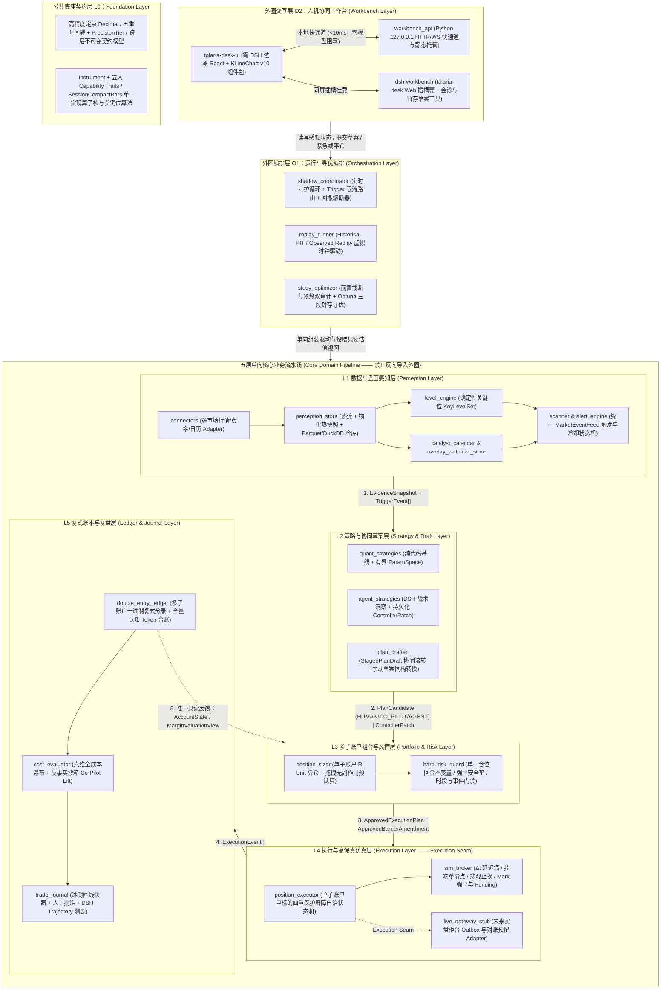
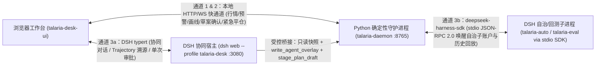

# Talaria 系统分层架构与模块接口规范

本文档定义 Talaria 多资产人机协同智能体研究与模拟交易系统的全局软件分层、模块接口（Interface）、可替换缝隙（Seam）、数据模型、高保真仿真物理法则以及单机轻量化部署拓扑。领域统一术语以根目录 [GLOSSARY.md](../GLOSSARY.md) 为准，核心架构决策记录于：

- [ADR-0001：采用 DeepSeek Harness 与 Python 确定性底座分离的双平面架构](./adr/0001-dual-plane-dsh-and-python-core.md)
- [ADR-0002：通过通用标的内核与 Capability Traits 市场包实现跨资产扩展](./adr/0002-capability-traits-and-market-packs.md)
- [ADR-0003：在完整执行计划层设置 Execution Seam，模拟优先并暂缓实盘柜台对接](./adr/0003-plan-level-execution-seam-simulation-first.md)
- [ADR-0004：采用确定性异动扫描前置门禁与日内快慢双模认知机制](./adr/0004-dual-mode-intraday-cognition-and-scanner-gate.md)
- [ADR-0005：看盘工作台采用本地快通道直连 Python 底座并与 DSH 插槽解耦](./adr/0005-fast-path-bypass-and-decoupled-chart-workbench.md)
- [ADR-0006：采用多虚拟子账户单标的单一仓位回合模型与按写者物理分库](./adr/0006-single-position-round-per-subaccount-and-isolated-ledgers.md)
- [ADR-0007：将防过拟合 Optuna 参数寻优置于外圈编排层并强制前置门禁与三段封存](./adr/0007-guarded-optuna-optimization-in-outer-orchestration.md)
- [ADR-0008：初版以人机共用分析工作台为先，并由确定性关键位引擎产出重要价位](./adr/0008-analysis-first-v1-and-deterministic-key-level-engine.md)
- [ADR-0009：以模型知识截止日划分智能体评估证据等级，历史回放默认仅作诊断](./adr/0009-agent-evaluation-evidence-tiers-by-model-knowledge-cutoff.md)

*(前置外部接口与开源底座许可核查证据存档于 [`docs/research/`](./research/)。)*

---

## 1. 全局软件分层架构（`1 底座 + 5 单向核心业务层 + 2 外圈编排与交互层`）

为同时满足“人机协同双轨分析（`Co-Pilot Analysis`）”、“人工操作零大模型阻塞”与“核心流水线严格单向无环”三大约束，全系统划分为 **1 个公共底座契约层（L0）**、**5 个自上而下严格单向流转的核心业务层（L1–L5）**，以及 **2 个站在核心流水线外侧单向组装调用的编排与交互层（O1–O2）**。



### 1.1 分层依赖与权限铁律

1. **核心五层严格单向无环**：包导入与同步业务流仅允许沿 `L1 → L2 → L3 → L4 → L5` 推进（核心五层均只依赖 `L0` 契约对象，互不反向导入上游或外圈 `O1/O2`）。全系统唯一的闭环数据流是 `L5` 产出的不可变值对象 `AccountState`（及派生的只读保证金估值视图 `MarginValuationView`），由外圈 `O1` 读取后单向传入 `L3` 定仓风控与 `L4` 全仓维持保证金检查。
2. **开仓与放宽风险必过 L3，收敛风险允许直达 L4**：
   - 任何新建仓、同向加仓以及**放宽活跃仓位止损距离**的操作（无论来自 `HUMAN`、`CO_PILOT` 还是 `AGENT`），一律必须经过 `L3` 组合风控层校验逻辑证伪止损价、单笔风险上限与衍生品强平安全垫；
   - **只减不增风险的避险操作**（向有利方向收紧止损、移至保本、撤销未成交入场单、主动市价减仓/全平、将子账户切入 `REDUCING` 或 `HALTED`）允许由 `O1/O2` 直达 `L4` 执行引擎毫秒级生效，`L4` 内部硬断言风险敞口单调不增，绝不回调 `L3`。
3. **跨品种零条件分支**：`L1–L5` 核心模块只面向 `L0` 的五大能力特征接口编程，加密永续与美股日内的场所差异全部隔离在横向 `packs/<market>/` 插件包中注册。

### 1.2 量化策略支持范围与预留扩展点

纯量化策略与人工、协同、智能体三类来源共用同一条 `L2 → L5` 流水线，并独享 `ReplayRunner` 与 `StudyOptimizer` 寻优链路。受 `R` 定仓（[ADR-0002](./adr/0002-capability-traits-and-market-packs.md)）与单一仓位回合不变量（[ADR-0006](./adr/0006-single-position-round-per-subaccount-and-isolated-ledgers.md)）约束，当前支持范围如下：

| 量化形态 | 当前支持 | 约束来源 |
|---|---|---|
| 单标的趋势 / 突破 / 均值回归择时（分钟级及以上） | 支持 | — |
| 资金费率、OI 背离、基差等衍生品信号 | 支持 | — |
| 慢层 `ControllerPatch` 调参 + 快层纯代码控制器 | 支持 | — |
| 横截面多因子 / 目标权重组合再平衡 | 不支持 | `L3` 仅按止损距离反推数量，无目标权重定仓路径 |
| 配对 / 统计套利 / 多腿对冲 | 仅可拆为互相独立的回合，无原子开平与价差屏障 | `PositionExecutor` 以单标的回合为粒度 |
| 同一子账户同标的多空对冲或多子仓 | 禁止（可拆分子账户） | 单一仓位回合不变量 |
| 无止损策略（网格、定投、持有型） | 不支持 | `invalidation_price` 必填 |
| 做市 / 订单簿高频 / 跨所低延迟套利 | 范围外 | 定位为分钟级及以上 |

预留扩展点（均不改变核心五层单向依赖，需要时另立 ADR，不进入首个里程碑）：

1. **组合再平衡**：`L2` 新增 `PortfolioIntent`（目标权重）输出形态，`L3` 新增与 `R` 定仓并列的 `TargetWeightSizer`（按波动率或风险预算折算数量），`L4` 按差额生成多个回合。
2. **多腿篮子**：在 `L3/L4` 之间引入 `BasketPlan`，由回合组承载多腿并以价差定义屏障；会改变 `PositionExecutor` 粒度，是三项中改动最大的一项。
3. **替代定仓模式**：子账户可声明名义金额或波动率定仓，此时止损降为可选保护项，`R` 相关风控步骤按模式切换。
4. **离线研究循环**：在 `O1` 旁设研究编排器，由智能体提出假设、生成策略代码并在沙箱回放中迭代；产出只能以新的 `quant_strategies` 版本经 `StudyOptimizer` 全部门禁与人工签字后上线，研究进程不持有任何运行态写权限。

### 1.3 初版范围与里程碑

按 [ADR-0008](./adr/0008-analysis-first-v1-and-deterministic-key-level-engine.md)，初版先交付人机共用的分析工作台，分层不变，只调整实现顺序：

| 里程碑 | 交付内容 | 涉及分层 |
|---|---|---|
| M1 | `Bybit V5 Linear` 数据接入与冷库；指标算子；关键位引擎；`talaria up --solo` 看盘页（指标 + `SYSTEM_LEVEL` 图层）；价位预警；分析接口按工具形态设计 | `L0`、`L1`、`O2`（无 DSH） |
| M2 | 接入 DSH 协同：读取指标与关键位做解读、会诊与 `AGENT_ANNOTATION` 标注；后台扫描简报 | `L2`（洞察只读）、`O2` |
| M3 | 交易闭环：`L3` 风控、`L4` 模拟撮合、`L5` 账本与复盘、`ReplayRunner` | `L2–L5`、`O1` |
| M4 | `talaria-auto / talaria-eval` 智能体自治与评估、`StudyOptimizer`、`us_equity` 市场包 | `O1`、`packs/` |

---

## 2. 单仓库目录结构与跨语言契约流水线

代码目录与上述 `L0 + L1..L5 + O1..O2` 分层严格同构：

```text
Talaria/
├── GLOSSARY.md                         # 领域统一词汇表
├── contracts/                          # Python 自动导出的跨语言 JSON Schema 与算子黄金测试向量
│   ├── schemas/
│   └── operator_vectors/
├── configs/                            # 运行态 Profile、虚拟子账户模板、风控与仿真摩擦配置
├── core/                               # Plane B：Python 确定性底座（uv 管理）
│   ├── pyproject.toml
│   └── src/talaria/
│       ├── foundation/                 # 【L0】Decimal、五重时点、Instrument+5 Traits、契约对象、MarketEventFeed 协议、紧凑序列算子核、关键位纯函数算法
│       ├── feed/                       # 【L1】实时行情状态机（LIVE/STALE/RECOVERING、NO_TRADES 与 FEED_GAP 合成、重连幂等回填）
│       ├── replay/                     # 【L1】JSONL 确定性回放传输层（断流/恢复段、可注入时钟）
│       ├── perception/                 # 【L1】connectors、perception_store、catalyst_calendar、watchlist、overlays、level_engine、alerts_scanner
│       ├── strategy/                   # 【L2】Strategy 协议+ParamSpace、quant_strategies、dsh_agent_runner、plan_drafter
│       ├── portfolio_risk/             # 【L3】subaccount_guard、r_unit_sizer、correlation_budget、hard_risk_pipeline
│       ├── execution/                  # 【L4】ExecutionEngine Seam、position_executor、sim_broker、live_gateway_stub
│       ├── ledger_journal/             # 【L5】double_entry_ledger、cognition_cost_book、cost_evaluator、trade_journal
│       ├── orchestration/              # 【O1】shadow_coordinator、drawdown_breaker、replay_runner、study_optimizer (Optuna)
│       ├── workbench_api/              # 【O2-后端】127.0.0.1 HTTP/WS 快通道网关、StateWriterQueue、独立静态看盘托管
│       ├── packs/                      # 【横向市场规则包】
│       │   ├── crypto_perp/            #   Bybit V5 / Binance(+Vision归档) / Hyperliquid 连接器 + 永续保证金与 Funding 规则
│       │   └── us_equity/              #   Alpaca(IEX/SIP) / Finnhub+SEC EDGAR / BLS+BEA+FOMC+ALFRED + 美股时段与 PDT 规则
│       └── cli/                        # 统一命令入口（up / replay / optimize / study-ui / contract-check）
├── dsh/                                # Plane A：前端看盘包与 DeepSeek Harness 插件工程（pnpm workspace）
│   ├── package.json
│   ├── pnpm-workspace.yaml
│   └── packages/
│       ├── talaria-contracts/          # 由 contracts/ 自动生成的 TS 类型与 DSH 合规子集 Schema
│       ├── talaria-desk-ui/            # 【O2-前端核心】零 DSH 耦合的 React + KLineChart v10 画线/预警/日历/下单/复盘组件包
│       ├── dsh-bridge/                 # DSH 宿主与 Python 底座受控通信桥、单调执行守卫
│       ├── dsh-strategy-agents/        # 【归属 L2】静态纪律前缀、PTC 同口径算子绑定、市场领域 Skills
│       └── dsh-workbench/              # 【O2-插件壳】talaria-desk / talaria-auto / talaria-eval Profile 与 ui-slots 挂载壳
├── tests/                              # 与分层同构的契约测试、算子黄金对齐测试与仿真复式账本回归测试
└── docs/
    ├── architecture.md                 # 本架构规范
    └── adr/                            # 架构决策记录 (ADR-0001 .. ADR-0007)
```

---

## 3. 各层职责与公开接口契约

### 3.1 公共底座契约层（L0 `foundation`）

封装全层通用的数值精度、时间因果模型、跨资产特征协议与纯数学算子核，不包含任何网络或磁盘 I/O：

1. **定点十进制与五重时点纪律**：
   - 所有价格、数量、名义本金、手续费、资金费率与账户余额在 Python 内强制使用 `Decimal`，跨 JSON 边界一律序列化为十进制字符串（`DecimalStr`），仅在前端 `KLineChart` Canvas 像素绘制最后一跳转换为浮点数。
   - 所有市场与事件事实显式区分五重时间戳：`ts_event`（`Event Time`）、`ts_published`（来源声称发布时刻）、`ts_available`（`Available Time`）+ 精度等级 `PrecisionTier`（`SECOND_VERIFIED | SESSION_BOUND | DATE_CONSERVATIVE`）、`ts_ingested`（系统接收时刻）与 `ts_committed`（`Committed Time`）。
2. **`InstrumentSpec` 与五大可组合能力特征（`Capability Traits`）**：

| 特征接口 | 封装的市场与数据源差异 | 加密永续合约示例 (`BTC-USDT-PERP`) | 美股日内示例 (`NVDA.NASDAQ`) |
|---|---|---|---|
| `FeedCapabilityTrait` | 数据源标识 `feed_id`、实时供流窗口、心跳超时、REST 回溯上限、归档回填器 | `BYBIT_LINEAR` 全历史免密钥；`BINANCE_USDM` 近 30 天 REST + 远端归档补齐；`HYPERLIQUID_PERP` 实时落盘补 5,000 根限制 | `ALPACA_IEX`（实时仅 `08:00–17:00 ET`，≤30 标的稀疏单场所）与 `ALPACA_SIP`（历史延迟 ≥15m 全市场）严格分流标记 |
| `MarginTrait` | 保证金制度、杠杆上限、未实现盈亏与强平估值基准价 | `CROSS / ISOLATED` 初始与维持保证金率，强制按 `Mark Price` 判定强平 | `CASH`（全额现金禁做空）或 `REG_T`（日内 4x / 隔夜 2x 融资） |
| `CarryTrait` | 持仓跨越结算周期的现金流计提 | 整点（1h/4h/8h）按持仓名义价值与 `FundingRate` 多空直接收付 | 融券空头按年化费率跨结算日计提借券利息 |
| `SessionTrait` | 可交易时段、场所供流联动保护与强平窗口 | `24x7` 连续交易 | 盘前 / 常规 RTH / 盘后分段；绑定 `ALPACA_IEX` 实时源时自动限制在有实时报价覆盖窗口内持仓（默认 ≤`16:55 ET` 平仓） |
| `OrderConstraintTrait` | 委托标志、做空准入与监管频次限制 | 原生双向开空、支持 `POST_ONLY` 与 `reduce_only` | 非 RTH 时段禁用市价单；`< $25,000` Reg-T 账户受滚动 5 交易日 PDT 次数硬约束 |

3. **双层时间序列与单一实现确定性算子核（`foundation/operators`）**：
   - **横截面网格表（`GridAlignedTable`）**：保留正常休市（`SESSION_CLOSED`）、停牌（`HALTED`）、时段内无成交（`NO_TRADES`）与异常断流（`FEED_GAP`）显式状态，服务多品种横截面对齐。
   - **单标的紧凑交易序列（`SessionCompactBars`）**：剔除正常休市 `SESSION_CLOSED` 空槽，与前端 `KLineChart v10` 的 `dataList` 下标严格 `1:1` 等长对齐。所有单标的技术与衍生品算子（EMA、SMA、RSI、ATR、BOLL、VWAP、资金费率分位数、OI 背离度、净赔率几何验算）均定义为纯函数：输入长度 $N$ 严格输出长度 $N$（仅预热期输出前导 `null`）；时段内 `NO_TRADES / HALTED` 按前收盘平盘零量柱保态递推；**一旦遭遇真实异常断流 `FEED_GAP`，递归算子立即输出 `null` 并强制重跑完整 `warmup_bars` 预热期**。
   - **算子只在 Python 中实现一份**：底层数值计算复用 `TA-Lib`（BSD，冷库批量）与 `talipp`（MIT，热流增量），本层薄封装负责前导 `null`、紧凑序列与 `FEED_GAP` 重预热语义，并以 `contracts/operator_vectors/` 黄金测试向量做回归。前端 `KLineChart` 的 `registerIndicator` 只渲染 Python 推送的指标值，PTC 通过宿主工具调用 Python 算子，二者均不自行计算。
4. **关键位纯函数算法（`foundation/levels`）**：摆动高低点（按 ATR 阈值的分形 / ZigZag，多周期）、触及价位聚类、成交量分布（`POC / VAH / VAL`）、锚定 VWAP 与 `±σ` 带、时段参考位、跳空缺口与整数关口的识别均为无 I/O 纯函数。**摆动类算法严禁使用确认点之后的数据**：枢轴须经 `confirm_bars` 根后续 K 线确认后才产出，其可见时刻记为确认 K 线收盘时刻。

---

### 3.2 第一层：数据与盘面感知层（L1 `perception`）

作为市场历史事实、事件日历与人机看盘状态的唯一事实源，向下游交付无前视泄漏的 `EvidenceSnapshot` 与高信噪比 `TriggerEvent`：

1. **冷热一体时点存储与热端冻结物化（`PerceptionStore`）**：
   - **冷库单写者发布**：`data/raw/` 原始存档（含内容哈希）→ staging Parquet 质检 → 不可变 generation Parquet 落盘并 `fsync` → `data/data_manifest.sqlite` 短事务提交清单版本与游标。
   - **实时热流与物化保障**：`HotStreamBuffer` 维护实时 BBO、进行中/闭合 K 线（带 `is_closed` 与 `bar_revision`）及衍生品上下文；在实时 `Shadow Run` 中，每当因触发唤醒、人工会诊或计划开平仓调用 `freeze_snapshot(req)` 时，自动将尚未归入冷库的热端窗口切片即时物化落盘至 `state/hot_snapshots/<snapshot_id>.parquet` 并登记于 `state/runtime_snapshots.sqlite`，确保进程重启或内存环淘汰后任意历史交易快照仍可 100% 重现。
   - **双时点回放模式**：`HISTORICAL_PIT` 约束 `ts_available <= cutoff_ts`；`OBSERVED_REPLAY` 同时约束 `ts_available <= cutoff_ts` 且 `ts_committed <= cutoff_ts`。`DuckDB` 仅只读扫描快照清单显式列出的 Parquet 文件集合，严禁目录通配符读取。
2. **`Catalyst Calendar`（事件日历）双时间模型与防前视折算**：
   - 预期侧存储 `scheduled_date`、`scheduled_session`（`BMO | DMH | AMC | EXACT_UTC | DATE_ONLY`）、`scheduled_ts_utc`（由 BLS `.ics`、BEA JSON/ICS、FOMC 官方时刻表提供如 `08:30 ET` / `14:00 ET` 精确钟点；近端财报排期由 Finnhub 免费层每日增量快照积累）与排期获知时刻 `schedule_available_ts`。
   - 实际披露侧存储 `actual_payload`、`ts_available` 与 `PrecisionTier`：美股财报实际披露采用免密钥 **SEC EDGAR `submissions`（`8-K` Item `2.02` / `10-Q` / `10-K`）** 经美东时区与 Reg S-T `17:30 ET` 规则校准后的秒级 `acceptanceDateTime`（辅以 Alpaca News 秒级 `created_at`），严禁爬虫抓取违规站点；宏观修订序列接入 FRED / ALFRED `vintagedates`。
   - **防前视硬裁剪**：当 `cutoff_ts < effective_available_ts` 时隐藏 `actual_payload`（置为 `UNRELEASED`）：`SECOND_VERIFIED` 取精确秒级时刻；无秒级证据的 `SESSION_BOUND` 将 `BMO` 保守折算至当日 `09:30 ET`、将 `AMC` 保守折算至当日 `20:00 ET`（二者由 `us_equity` 市场包的 `SessionTrait` 提供）；仅有日期的 `DATE_CONSERVATIVE` 一律推迟至事件所属市场 `SessionTrait.next_regular_open(date)` 返回的下一常规开盘时刻（美国宏观数据挂美股日历，纯加密事件按来源时区当日结束加可配置缓冲），`L1` 不写死任何市场时区。对缺少免费历史事前排期的早期美股回测区间，显式标记 `EarningsScheduleCoverage = EX_POST_ONLY` 并在报告披露，严禁借事后 `8-K` 伪造盘前静默门禁。
3. **`Watchlist`、共享 `Chart Overlay` 与统一 `MarketEventFeed` 预警扫描**：
   - `Watchlist` 按“活跃持仓 > 挂有活跃预警 > 当前看盘标的 > 普通自选”动态调度有限实时订阅配额。
   - 向量化 `Scanner` 与毫秒级 `AlertEngine`（支持价格/衍生品阈值、技术指标交叉、`Chart Overlay` 几何插值触碰/收盘突破、关键位事件 `LEVEL_EVENT`（触及 / 突破 / 回踩，按 `level_id` 跟踪）、催化剂倒计时五类规则及 `ARMED → COOLDOWN / EXPIRED` 状态机）统一消费 `MarketEventFeed` 协议，在实时热流与历史冷库回放间共享同一套触发与冷却代码；仅在场所合法供流窗口内发生传输心跳失联或丢包时才判 `FEED_GAP / STALE` 挂起触发，正常稀疏分钟记为 `NO_TRADES`。
4. **`MarketEventFeed` 实时传输实现（03 已落地）**：
   - `foundation/feed.py` 定义跨数据源统一的 `KlineEvent`（含 `confirmed` 与单调递增 `revision`）、`OrderBookEvent`、`FeedHealthEvent` 与 `MarketEventFeed` 协议；这些契约同时导出 JSON Schema 与 TypeScript 类型，前后端共用同一份形状。
   - `feed/supervisor.py` 持有唯一状态机：12s（默认 `stale_after_ms=12000`）无任何事件即 `LIVE → STALE`；传输层报错立即 `STALE`；重连成功后先 `RECOVERING` 并应用 REST 回填，再回 `LIVE`。断流窗口以“最后一根已知柱的事件时间 + 断流墙钟时长”记录，因此历史回放（事件时间与运行墙钟错位）不会伪造未来时间戳的缺口。
   - 缺口合成口径与 `perception/compaction.py` 共用 `classify_flat_bar`：正常稀疏分钟补前收平盘零量的 `NO_TRADES`；断流窗口内补 OHLCV 全空的 `FEED_GAP`。同一 `timestamp` 的多次发布按 `revision` 追加保留、last-write-wins，REST 回填与实时推送可安全重放。
   - `packs/crypto_perp/stream.py` 是 Bybit V5 Linear 公共 WS 传输层（`websockets>=15`）：topic 为 `kline.{interval}.{symbol}` 与 `orderbook.1.{symbol}`，等待订阅 ack、应用层 ping/pong、断线由 supervisor 指数退避重连；连接失败抛 `FeedTransportError`。
   - `workbench_api` 暴露 `GET /api/feed/health` 与 `WS /ws/desk`：每客户端一条有界队列（256，“满则丢最旧”），慢客户端不会阻塞广播；前端 `useMarketStream` 按页面地址推导 WS URL、指数退避重连，并在标的/周期切换时先退订再订阅。图表增量走 KLineChart v10 的 `DataLoader.subscribeBar`（同 timestamp 更新、新 timestamp 追加），`FEED_GAP` 永不进入 `dataList`。
   - `talaria up --solo --replay-events <path> [--replay-speed F]` 用 JSONL 回放驱动上述整条链路，用于离线确定性与浏览器验收；`--fixture-dir` 仅提供历史快照，`/api/health.feed_mode` 区分 `fixture` / `replay` / `bybit`。

5. **确定性关键位引擎（`level_engine`）**：
   - 调用 `L0 foundation/levels` 算法，仅基于 `<= cutoff_ts` 的已可见数据产出不可变 `KeyLevelSet` 并随 `EvidenceSnapshot` 交付；实时态按闭合 K 线增量更新。
   - 初版价位类别：① 结构位（确认后的摆动高低点、多次触及聚成的支撑阻力区间）；② 时段参考位（前日高 / 低 / 收、周与月开盘价、开盘区间、加密亚洲 / 伦敦 / 纽约时段高低点，美股盘前高低点由 `us_equity` 包提供）；③ 成交量位（`POC / VAH / VAL`、锚定 VWAP 及 `±σ` 带）；④ 未回补跳空缺口与整数关口；⑤ 基于 OI 变化与杠杆假设推算的清算密集区（`kind` 标注 `ESTIMATED`，与观测类价位分开展示）。
   - 契约 `KeyLevel`：`level_id`（跨快照稳定）、`instrument_id`、`kind`、`price` 或 `[low, high]` 区间、`timeframe`、`strength` 及其构成（触及次数、最近触及时刻、成交量权重）、`status`（`ACTIVE | BROKEN | FLIPPED`）、`ts_available`、`method_version` 与参数。
   - **质量评估**：离线统计各 `kind` 被触及后 `X` 倍 ATR 内出现反应的比例并与随机价位对照；人工在图表上的采纳 / 忽略操作记入协同状态库，供后续调整强度权重。

---

### 3.3 第二层：策略与协同草案层（L2 `strategy`）

消费冻结 `EvidenceSnapshot` 产出方向观点或受限参数补丁，不感知账户本金，不直接触碰执行层：

```python
class Strategy(Protocol):
    param_space: ParamSpace

    def evaluate(
        self,
        snapshot: EvidenceSnapshot,
        triggers: list[TriggerEvent],
        active_patch: ControllerPatch | None = None,
    ) -> StrategyDecision:
        """返回 list[SetupInsight]、有界 ControllerPatch 或显式 Abstain。"""
```

1. **三类同构输入流汇合**：
   - `quant_strategies`：纯 Python 确定性策略，既是快慢双模架构中的毫秒级执行载体，也是衡量智能体净超额收益的永久基线对照组；
   - `agent_strategies`：按“静态风控契约前缀 → 匹配 `Market Pack` 的领域 `Skill` → 当前快照增量”三段式组装提示词以最大化前缀缓存命中率，强制在 `@deepseek-ai/dsh-ptc-runtime`（PTC）中调用同口径算子禁止心算；凡缺止损价、多空止损/止盈几何倒挂、越界引用或推理超时，适配器一律强制降级为 `Abstain`；
   - `plan_drafter`：管理人机协同下的 `StagedPlanDraft`（`STAGED → MODIFIED → SUBMITTED | DISCARDED | EXPIRED`）及纯人工手动建仓表单，统一封装为带互斥 `DecisionOrigin`（`HUMAN | CO_PILOT | AGENT`）的 `PlanCandidate` 送入 `L3`。**草案提交时重新冻结快照**：`L3` 以提交时刻的新快照审批，入场价带已被越过或已触及止损时返回 `DRAFT_STALE`；草案生成至提交之间的时长记为 `deliberation_ms` 单独留档，不计入 `Decision Latency`。
2. **`ControllerPatch` 生命周期**：慢层智能体签发的 `ControllerPatch` 仅允许修改目标策略 `ParamSpace` 白名单边界内的参数，携带 `valid_until_ts` 与 `dsh_turn_id` 持久化于协同状态库，到期未续签自动回退默认基线参数；生效期内触发的交易标记 `cognition_mode = CONTROLLER_PATCH` 以支持完整轨迹归因。

---

### 3.4 第三层：多子账户组合与风控层（L3 `portfolio_risk`）

全系统新建仓、同向加仓及放宽止损距离的**唯一确定性放行防火墙**：

1. **虚拟子账户（`Sub-Account`）隔离与单一仓位回合不变量**：
   - 每个 `Sub-Account` 独立配置初始资金、计价币种、保证金模式、风险单元比例 `r_unit_pct`、相关性簇上限、回撤熔断阈值及 `TradingState`。
   - **单一仓位回合（`Position Round`）硬不变量**：同一 `(sub_account_id, instrument_id)` 在同一时刻最多只允许存在一个方向的活跃或挂单仓位回合；同向获批加仓合并入当前活跃回合统一管理屏障与成本，反向开仓草案在本层直接拒单（`OPPOSITE_POSITION_OPEN`，须先平清当前回合再反手），多策略或人机独立对照通过拆分不同虚拟子账户实现。
   - **同向加仓沿用回合屏障**：加仓以 `AddOnCandidate` 提交并必须携带目标 `round_id`，不自带新的 `ExitBarrierSpec`；本层按当前回合止损计算加仓后整个回合的总风险，不得突破 `max_single_r_pct`。需要不同止损时，先经收紧直通或 `approve_barrier_widening` 改动回合屏障，再提交加仓，杜绝借加仓放宽止损。
   - **按子账户串行审批与风险预留（`Risk Reservation`）**：`O1` 为每个 `sub_account_id` 维护一条串行审批队列，`evaluate_candidate → submit_plan → 登记预留` 在同一临界区内完成；预留记录已放行但账本尚未可见的 `R`、保证金与仓位回合，对应 `ExecutionEvent` 入账或计划撤销 / 拒绝后释放。传入本层的 `AccountState` 由账本投影叠加预留合成，单一仓位回合不变量与风险簇检查同样计入预留，消除“两笔计划同时看到旧状态”的时间窗。
2. **公开深接口**：
   - `evaluate_candidate(candidate: PlanCandidate, account_state: AccountState, snapshot: EvidenceSnapshot) -> ApprovedExecutionPlan | RejectedPlanRecord`
   - `approve_barrier_widening(req: BarrierWideningRequest, account_state: AccountState, snapshot: EvidenceSnapshot) -> ApprovedBarrierAmendment | RejectedPlanRecord`
   - `preview_sizing(draft: StagedPlanDraft, account_state: AccountState, snapshot: EvidenceSnapshot) -> SizingPreview`（纯函数无副作用试算，支撑前端拖动止损线 `< 5ms` 实时回显仓位与强平距离）。
3. **七步确定性硬风控流水线**：
   - ① 校验子账户 `TradingState == ACTIVE`、日内与峰值回撤未触熔断线，且 `invalidation_price` 必填、方向几何合法；
   - ② 按止损距离与双边摩擦缓冲 $c_{\text{buf}}$ 反推风险单元数量（手动指定数量时反算隐含亏损不得突破 `max_single_r_pct`）：
     $$Q_{\text{raw}} = \frac{E_{\text{sub}} \times r_{\text{unit}}}{\left(\lvert P_{\text{entry,worst}} - P_{\text{stop}} \rvert + P_{\text{entry,worst}} \times c_{\text{buf}}\right) \times M}$$
   - ③ 校验同一子账户相关性簇未锁定在途与持仓风险敞口 $\sum R_{\text{open}}$（移动止损已越过保本线的仓位释放原 $R$ 占用）未超簇上限；
   - ④ 校验 `SessionTrait`（含 `ALPACA_IEX` 供流窗口持仓收窄约束）、`OrderConstraintTrait`（非 RTH 禁市价单、PDT 剩余回合数）及可选重大催化剂事前静默窗口；
   - ⑤ 按 `MarginTrait` 与最新 `Mark Price` 核算初始保证金充足率，并强制硬止损先于强平触发（留足安全缓冲垫）：逐仓按单仓预估强平价 $P_{\text{liq}}$ 校验；全仓改由 `MarginTrait.account_liquidation_check(positions, marks)` 做账户级压力测试——假设本标的走到止损价、其余持仓维持当前 `Mark Price`（可选同风险簇持仓同时走到各自止损），账户维持保证金率仍须高于安全线；
   - ⑥ 按 `CarryTrait` 扣除预估手续费、冲击滑点与预计持仓上限期内资金费率/融券成本后，校验净收益风险比达标；
   - ⑦ 签发不可变 `ApprovedExecutionPlan`（冻结 `plan_id`、`round_id`、`sub_account_id`、`DecisionOrigin`、`ExitBarrierSpec`（加仓计划引用回合现有屏障）与 `ts_decision`）。

---

### 3.5 第四层：执行与高保真仿真层（L4 `execution` —— `Execution Seam`）

托管单子账户单标的仓位回合从建仓、同向加仓合并到四重屏障退出的全闭环，对外暴露严守单向风险纪律的六方法深接口：

```python
class ExecutionEngine(Protocol):
    def submit_plan(self, plan: ApprovedExecutionPlan) -> PlanReceipt: ...
    def tighten_barrier(self, req: BarrierTightenRequest) -> BarrierReceipt: ...
    def apply_approved_amendment(self, amendment: ApprovedBarrierAmendment) -> BarrierReceipt: ...
    def intervene_position(
        self, round_id: str, action: Literal["CANCEL_ENTRY", "CLOSE_ALL", "REDUCE_RATIO"], ratio: Decimal | None, reason: str
    ) -> RoundStatus: ...
    def set_trading_state(self, sub_account_id: str | None, state: TradingState, reason: str) -> None: ...
    def poll_events(self, up_to_ts: int) -> list[ExecutionEvent]: ...
```

1. **`PositionExecutor` 本地自治四重保护屏障（`Exit Barrier Set`）状态机**：每个 `PositionExecutor` 托管一个完整 `Position Round`（而非单笔计划），同向获批加仓并入该回合并沿用回合屏障；
   - 状态流转：`PENDING_ENTRY → PARTIALLY_FILLED_PROTECTED → ACTIVE_PROTECTED → EXITING → CLOSED | CANCELLED | LIQUIDATED`。首笔部分成交瞬间立即按已成交量挂载硬止损、止盈、激活式单调移动止损与 `max_holding_ms` 垂直时间上限，全程在本地毫秒/Tick/K线级独立闭环，不依赖大模型或工作台在线。
2. **`SimExecutionAdapter` 六条诚实仿真物理法则**：
   - ① **决策延迟墙（`Decision Latency Δt`）**：冻结于 $t_{\text{decision}}$ 的计划必须在 $t \ge t_{\text{decision}} + \Delta t$ 之后的盘口/K线方可参与撮合；
   - ② **微观挂吃单区分**：`POST_ONLY` 穿价即拒；`LIMIT` 须后续行情实质穿价才计 Maker 费率；主动吃单叠加点差与冲击滑点并计 Taker 费率；
   - ③ **同根 K 线悲观止损优先**：无逐笔路径时同根 K 线同时触及止损与止盈一律按先止损结算；
   - ④ **跳空真实滑点**：开盘跳空越过止损位时按跳空后真实可成交价结算；
   - ⑤ **永续 `Mark Price` 强平与周期持仓现金流**：由外圈 `O1` 在每步显式投喂只读 `MarginValuationView`，严格按 `Mark Price` 实时检查全仓/逐仓维持保证金率并触发 `PositionLiquidated`；跨越整点按 $-\text{signed\_qty} \times M \times P_{\text{mark}} \times R_{\text{funding}}$ 自动生成 `FundingSettled` 事件，美股空头跨日生成 `BorrowFeeAccrued` 事件；
   - ⑥ **字节级确定性可复现**：相同快照、摩擦配置与种子下事件序列逐字节一致。
3. **`LiveExecutionAdapter` 预留卡槽**：未来实盘接入时，持久化 Outbox、幂等 `client_order_id`、超时 `UNKNOWN` 主动查询对账及场所原生连接器全部封装在该 Adapter 内，上游 `L1–L3` 与下游 `L5` 零代码侵入。

---

### 3.6 第五层：复式账本与复盘层（L5 `ledger_journal`）

1. **多子账户十进制复式账本与全量认知成本台账（`DoubleEntryLedger`）**：
   - 采用仅追加 `ledger_entries` + `ledger_postings` 双表，按 `(run_id, sub_account_id, currency)` 隔离核算可用现金、挂单冻结、全仓/逐仓保证金、已结毛利、手续费、资金费率/融券收支与强平罚金，每次写入强制校验借贷差严格为 `Decimal('0')`。
   - **子账户级全量认知成本流水（`EXPENSE_LLM_COGNITION`）**：每一次 DSH 模型调用（涵盖最终成交、`Abstain`、`L3` 拒单、挂单超时取消、人工废弃草案、框选会诊与 `ControllerPatch` 调参）均实时写入认知成本流水；子账户区间净收益与净夏普强制扣减同期全部认知推理总开销，杜绝只统计成交单的幸存者偏差。
   - **用量采集通道**：`talaria-auto / talaria-eval` 由守护进程经 SDK 直接取得用量；`talaria-desk` 会话在开始时绑定 `sub_account_id`（随 `ConsultationPacket` 传入），由 `dsh-bridge` 在宿主侧（非模型可调用工具）于每轮结束时上报 `(dsh_session_id, dsh_turn_id, 输入 / 缓存命中 / 输出 Token)`，账本按 `(dsh_session_id, dsh_turn_id)` 幂等入账（`turn` 仅为会话内序号，不能单独作为幂等键）；`turn/end` 事件本身不含 usage，需在 bridge 侧折叠该 turn 内全部 attempt 事件，缺失或 `undefined` 的用量不得按 0 入账，须标记待补；守护进程定期扫描 `$DSH_HOME` 轨迹文件补齐漏报。无法归属的会话计入默认子账户的 `UNALLOCATED` 认知成本，不丢弃。（2026-11-19 核实：`deriveTurnTokenUsage` 非公开导出，bridge 侧需按同一规则自行折叠并以黄金测试锁定。）
2. **六维全成本瀑布与 `Co-Pilot Lift` 反事实评测（`CostAttributionEvaluator`）**：
   - 按完整 `Position Round` 精确拆解：`无摩擦理论毛利 − 决策延迟漂移(Δt) − 撮合滑点 − 交易所手续费 + 持仓资金费率/融券净额 − 关联认知 Token 成本 = 真实净收益`，与复式账本结转盈亏恒等对齐。
   - **`Co-Pilot Lift` 隔离沙箱评估**：对源出结构化 `StagedPlanDraft` 的协同交互，在草案生成时刻基于独立无副作用 `CounterfactualSimSandbox`（克隆当时子账户净值，不占用真实保证金与风险簇额度）跑完原始草案的 `L3→L4` 影子结果（原始草案被 `L3` 拒单则基准净利记 `0`，人工否决亏损草案记正避险增益），量化人机协同相对纯智能体的真实边际净贡献。
3. **`Trade Journal`（交易复盘日志）四维锚定模型**：
   - 每笔终态回合自动建档，永久绑定：① 完整执行、改止损与六维归因明细；② 开平仓物化 `snapshot_id` 及当时图上全部可见 `HUMAN_DRAWING / AGENT_ANNOTATION / EXECUTION_BARRIER` 的冰封 `frozen_overlays_json`（事后删改主图画线仍可原样重现复盘现场）；③ `dsh_session_id / dsh_turn_id / patch_id` 指向 `$DSH_HOME` 只读压缩 `Trajectory` 的溯源指针与草案修订前后 Diff；④ 人工纪律标签与复盘总结（盘后经验仅允许在完全平仓后携明确 `resolved_ts` 归档，历史回测检索强制过滤 `resolved_ts <= cutoff_ts`）。

---

## 4. 外圈编排、人机共享图表交互与防过拟合寻优规范

### 4.1 人机共享图表四图层与双轨交互契约（O2 `workbench`）

前端核心包 `talaria-desk-ui` 直接基于 `KLineChart v10`（Apache-2.0）构建，将画布图元物理隔离为四个独立图层。已锁定 `klinecharts 10.1.1` 正式版（2026-11-16 发布）：外部指标结果不能直接注入，需注册指标模板并以 `createIndicator({ name, calc })` 的 `calc` 回调返回与 `dataList` 等长同序的数组，更新时换新闭包并调用 `overrideIndicator`；历史分页使用 `setDataLoader`（`init / forward / backward / update` 与 `callback(data, more)`）。

| 图层标识 (`groupId`) | 写入主体与存储位置 | 交互与安全校验规则 |
|---|---|---|
| `HUMAN_DRAWING` | 交易员鼠标绘制；经本地快通道持久化于 `collaboration_state.sqlite` | 自由拖拽（前端 `60fps` 乐观重绘、松手落库）、撤销重做栈、一键挂载 `OVERLAY_CROSS` 盘面预警 |
| `SYSTEM_LEVEL` | 不入普通画线表；由 `L1 level_engine` 的 `KeyLevelSet` 经 WS 单向投影 | 只读；按 `kind` / 强度过滤显隐；一键“采纳”复制为 `HUMAN_DRAWING`，一键挂载 `LEVEL_EVENT` 预警；采纳 / 忽略操作记录为质量反馈 |
| `AGENT_ANNOTATION` | 智能体调用 `write_agent_overlay`；经硬门控校验后存入 `collaboration_state.sqlite` | **写入前硬门控**：① 校验 `snapshot_id` 与非空 `evidence_refs`（须引用系统 `level_id` 或具体 K 线时间戳，不得凭空给出价位）；② 所有价格锚点须为正、合乎 `tick_size` 且落在分析窗口 `[min_low - 3*ATR_14, max_high + 3*ATR_14]` 包络内，越界幻觉直接拦截；③ 限制单标的未采纳活跃条数（≤12 条），支持人工一键采纳转为实线或清理 |
| `EXECUTION_BARRIER` | 不入普通画线表；由后端 `StagedPlanDraft` 与活跃 `PositionExecutor` 经 WS 单向实时投影 | 拖动草案线实时触发 `L3.preview_sizing` 试算；拖动活跃仓位止损线根据收紧/放宽方向路由至 `L4.tighten_barrier` 或 `L3.approve_barrier_widening → L4`，杜绝图线与真实屏障脱节 |

**人机共用分析接口**：浏览器与智能体是同一套分析接口的两个调用方，二者读到的数据、算法与 `cutoff_ts` 完全一致，`level_id` 在双方之间共享。接口由 `workbench_api` 提供，经 `dsh-bridge` 包装为智能体工具：

| 接口 / 工具 | 作用 | 权限 |
|---|---|---|
| `get_snapshot` | 冻结截止时刻，返回 `snapshot_id`，后续调用均绑定该快照 | 只读 |
| `get_indicators(instrument, timeframe, names, params)` | 指标序列（默认仅最近 N 根 + 摘要统计） | 只读 |
| `get_key_levels(instrument, timeframes, top_n, kinds)` | 按强度排序的 `KeyLevel` 列表及强度构成 | 只读 |
| `compute_operator(...)` | 以非默认参数临时调用 Python 算子 | 只读 |
| `get_chart_view` | 当前标的、周期、视窗与可见 `HUMAN_DRAWING` | 只读 |
| `write_agent_overlay` | 写入智能体标注（经上表硬门控） | 受控写 |
| `create_alert` | 以草案形式创建预警，人工确认后生效 | 草案 |

返回值一律为带 `snapshot_id` 与稳定 ID 的结构化 JSON 加摘要；智能体不能修改系统关键位或指标结果。不接入自行拉取行情的第三方技术分析 MCP，以免绕过冻结快照。

### 4.2 外圈回测、熔断守护与 `Optuna` 防过拟合寻优（O1 `orchestration`）

1. **实时盘中回撤硬熔断守护（`DrawdownCircuitBreaker`）**：在 `ShadowCoordinator` 与 `ReplayRunner` 中持续监听 `Mark Price` 与账本变动；一旦子账户触及日内回撤软阈值自动置为 `REDUCING`，触及硬熔断线自动置为 `HALTED` 并按子账户 `liquidate_on_halt` 配置下发全平指令。
2. **基于 `Optuna`（MIT）的四道防过拟合寻优铁律（`StudyOptimizer`）**：
   - **适用范围**：截断前视审计与字节级确定性要求只适用于纯量化策略及智能体调用的确定性工具层；含 LLM 的策略按第 3 条证据等级评估。
   - **前置双审计门禁**：启动 `study.optimize()` 前强制执行 ① **截断式前视一致性审计**（随机抽取多个截断点 $t_k$ 断言 `cutoff=t_k` 与全区间快照下 $\le t_k$ 的输出逐字节一致）与 ② **递归指标预热漂移审计**（对比 `1x` 与 `2x warmup_bars` 起点偏差），任一不过直接阻断。
   - **三段式物理封存切分**：绑定不可变 `dataset_snapshot_id`，切分为 `Train` / `Validation`（交界处强制插入 $\ge \text{max\_holding\_ms} + \text{warmup}$ 的 `embargo` 隔离带） / `Holdout OOS`；迭代采样期传入 `ReplayRunner` 的读取器在接口层物理裁除 `Holdout OOS`（多目标模式禁用不支持的 `trial.report()` 剪枝，改用 `trial.set_constraint` 约束最低交易笔数与回撤上限）。
   - **全量试验计数留痕**：多 Worker 并发追加写入 `Optuna JournalStorage`，结束后由主进程将包含失败与淘汰试验在内的完整 `n_trials` 汇总写入 `study_registry.sqlite`。
   - **邻域平坦度与同源 `feed_id` 晋升门禁**：最优参数须先通过 `±5% / ±10%` 邻域微扰平坦度检验，再在封存 `Holdout OOS` 上执行唯一一次终审盲测；若寻优基于 `ALPACA_SIP` 而目标实时子账户为 `ALPACA_IEX`，禁止包含绝对成交量阈值且须补过 `ALPACA_IEX` 同源切片核验，人工签字后方可激活上线。
3. **智能体评估证据等级（[ADR-0009](./adr/0009-agent-evaluation-evidence-tiers-by-model-knowledge-cutoff.md)）**：数据层时点纪律挡不住模型权重中的记忆，因此 `AGENT / CO_PILOT` 评估按模型 Profile 声明的 `model_knowledge_cutoff` 分级：
   - `SHADOW_FORWARD`（Shadow Run 实时前向）与 `POST_CUTOFF_REPLAY`（区间严格晚于全部参与模型截止日 + 默认 30 天缓冲）是晋升、`Co-Pilot Lift` 与跨子账户对比的唯一证据来源，须计入手续费、资金费率与滑点，并报告样本长度与统计不确定性；
   - 其余回放一律记为 `DIAGNOSTIC`，只用于调试与缺陷排查；美股诊断回放同时运行匿名化对照（替换公司名、代码、产品与高管名，价格归一、日期相对化），加密永续诊断回放不用于评估 alpha；模型升级后落入新截止日的区间自动降级；
   - `decay = 指标(截止后) − 指标(截止前)` 作为常规指标并标注各窗口市场状态，财报与宏观事件驱动类策略只认前两类证据；
   - 回放中的 LLM 响应按 `(模型版本, prompt 哈希, snapshot_id)` 录制复用，实现“录制后可复现”。

---

## 5. 双平面通信拓扑、单机部署与数据库免锁隔离

### 5.1 智能体双宿主物理隔离与三通道 IPC



- **权限物理隔离**：`talaria-desk`（Web 协同 Profile）在 `cordis.patch.yml` 层物理不挂载直接提交正式计划工具，智能体在协同会话中只能写 `StagedPlanDraft` 待人工确认；自治子账户（`talaria-auto`）与历史回测（`talaria-eval`）均基于 `sdk-minimal` 物理剔除 `shell`、外网与文件写权限，统一由 Python 经官方 `deepseek-harness-sdk`（`stdio`）受控调用，实现实时自治与历史回测 100% 路径同构。
- **版本基线与探针**：截至 2026-11-19，DSH 尚无 stable release，本机基线锁定 `dsh 0.2.2-rc.3` 与 `deepseek-harness-sdk 0.2.2rc2`（`ui-slots 0.0.1-rc.1`、`typert` 仍为 0.x 预览版）；`dsh_bin` 显式指向本机 rc.3 可执行文件并显式设置 `dsh_home`，升级 DSH 或 SDK 前必须重跑 `dsh --dump-config --profile <name>` 与确定性探针。
- **三种轻量化运行态（零 Docker / 零 Redis / 零 Kafka）**：
  1. `talaria up`（日常实时 `Shadow Run`）：启动 `talaria-daemon` + `dsh web --profile talaria-desk`（加 `--solo` 参数时仅启动 `talaria-daemon` 单个进程，直接访问 `http://127.0.0.1:8765/desk` 纯人工独立看盘模拟）；
  2. `talaria replay`（历史批量回放）：单进程虚拟时钟回放，含智能体时按需池化拉起 `talaria-eval` 子进程；
  3. `talaria optimize --workers N`（多进程参数寻优）：$N$ 个只读共享冷库 Parquet 的 Worker 在各自 `:memory:` 内存账本中并发跑回测，结果追加写文件锁日志。

### 5.2 按唯一写者拆分的本地存储布局（根除 `SQLITE_BUSY`）

所有本地运行状态收纳于 `$TALARIA_DATA_DIR`，按**进程内唯一独占写者**物理拆分为 **5 个常驻正交 SQLite 库**（均开启 `WAL` 模式）、每次回放独立的运行库与追加文件目录：

| 存储路径 | 唯一独占写者 | 承载核心数据 |
|---|---|---|
| `data/raw/` & `data/lake/*.parquet` | 冷库采集发布器（只追加新批次） | 原始报文哈希存档、标准化多市场行情/衍生品/复权列式冷库 |
| `data/data_manifest.sqlite` | 冷库采集发布器单写者 | 数据集版本清单、`CatalystCalendar`、质检报告与抓取游标 |
| `state/runtime_snapshots.sqlite` + `state/hot_snapshots/*.parquet` | `talaria-daemon` 快照协调器单协程 | 实时 `Shadow Run` 触发/会诊/开平仓瞬间物化的热流增量切片与快照索引 |
| `state/collaboration_state.sqlite` | `talaria-daemon` 内 `StateWriterQueue` 单协程串行队列 | `Watchlist`、`AlertRule` 状态机、`OverlayRecord`、`StagedPlanDraft`、`ControllerPatch`、人工复盘批注及盘后已结算经验索引（强制 `resolved_ts <= cutoff_ts`） |
| `runs/<run_id>/run_state.sqlite`（寻优 Worker 改用 `:memory:`） | 该次回放进程单写者 | 回放期间的 `AlertRule` 状态推进、`ControllerPatch`、草案与关键位反馈；回放开始时从实盘协同库只读复制规则定义，**回放绝不写入 `state/collaboration_state.sqlite`** |
| `state/trading_ledger.sqlite`（回放分库至 `runs/<run_id>/ledger.sqlite`） | `talaria-daemon` 账本单协程（`synchronous=FULL`） | 多子账户十进制复式分录、持仓批次、全量认知 Token 成本流水与 `TradeJournal` 主档案 |
| `studies/study_registry.sqlite` + `studies/<id>/journal.log` | `talaria optimize` 主进程单写注册库；多 Worker 仅追加写 `journal.log` | Study 三段切分封存记录、累计总 `n_trials` 与邻域稳健性晋升审计记录 |

### 5.3 异常降级与跨缝隙自动化契约门禁

1. **优雅降级**：外部数据源在供流窗口内传输失联时置 `STALE` 挂起新触发，策略强制 `Abstain`，持续超限子账户自动降级 `REDUCING`；DSH 超时或离线时自动降级 `Abstain(MODEL_TIMEOUT)`，本地快通道人工看盘、画线、盘面预警弹窗与存量仓位四重保护屏障 100% 无损运行。
2. **五项自动化契约回归检查**：① Python `foundation` 导出 JSON Schema 与 `@talaria/contracts` 零漂移及十进制字符串类型断言；② DSH 工具 Schema 经 `assertSupportedJsonSchema` 子集规则（零根级 `$schema`、零未展开 `$defs`）静态门禁；③ `talaria-desk / talaria-auto / talaria-eval` 三个 Profile 的权限配置快照断言（`dsh --dump-config --profile <name>`，输出为含 `!!js` 的 YAML 风格文本而非 JSON），以及单调执行守卫的行为测试（守卫不出现在 dump 输出中，必须构造 `ctx.tools.guard` 场景断言其拦截历史轨迹 `fork` 重放）；④ `contracts/operator_vectors/` Python 算子与关键位算法黄金回归测试（含 `NO_TRADES` 与 `FEED_GAP` 重预热、摆动点确认延迟无前视断言）；⑤ 守护进程仅绑定 `127.0.0.1` 回环地址与会话随机 Bearer Token 鉴权基线断言。
